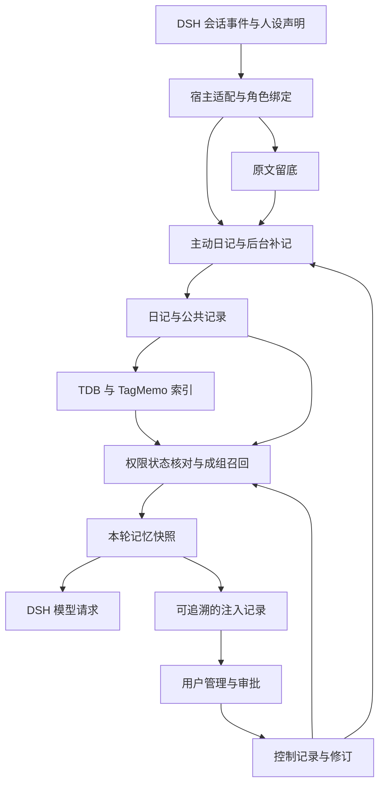

# DSH 记忆与陪伴系统详细设计

版本：设计稿 1.0  
日期：2026 年 11 月 13 日  
交付方式：一次完整交付，内部按依赖顺序开发和验证，不拆分对外发布的功能期次。  
用途：供使用者审阅、Claude 对照源码核实，并据此实现与验收。本文中的示例角色、日记和场景均为说明用的假设，不是新增的真实用户记忆。

## 阅读说明

本系统的目标是让同一个有固定人设的 agent 既能认真做事，也能通过持续的共同经历形成自然的陪伴感。日记是当前选定的记忆载体：它保留角色视角、时间和经历；原文与摘录提供回查依据；明确的管理规则让使用者能持续修正系统。

使用者愿意管理，前提是管理有效。因此，来源追查、具体改动预览、决定的持久生效和结果验证都是完整产品的核心功能，不是故障后的补丁。

本文采用三个状态标签：

| 标签 | 含义 |
|---|---|
| 已定约束 | 使用者已经确定，实施时不得自行重开 |
| 本文设计 | 本次给出的接口、规则和产品选择，是需要实现与验收的契约 |
| 需实测 | 依赖特定 DSH、TDB、Google 嵌入或 VCP 版本的行为，必须用源码位置和目标机器的实验确认 |

源码基线来自 Claude 的交接：DSH master，版本 `0.2.2-rc.3`；TDB 为 `triviumdb` 0.9.x 测试版。正式实施必须补充完整 commit、依赖锁文件和机器环境。本文没有把“交接中已找到接口”写成“目标机器已通过运行验证”。

## 目录

- [1 产品目标和范围](#1-产品目标和范围)
- [2 记忆如何服务 AI 与陪伴](#2-记忆如何服务-ai-与陪伴)
- [3 总体结构和职责](#3-总体结构和职责)
- [4 文件布局与权威来源](#4-文件布局与权威来源)
- [5 数据格式与状态契约](#5-数据格式与状态契约)
- [6 长期格式与内部接口](#6-长期格式与内部接口)
- [7 生命周期与操作语义](#7-生命周期与操作语义)
- [8 身份声明与公共传播](#8-身份声明与公共传播)
- [9 原文捕获与日记写入](#9-原文捕获与日记写入)
- [10 检索与本轮记忆](#10-检索与本轮记忆)
- [11 有效管理与回放预览](#11-有效管理与回放预览)
- [12 派生视图和整理](#12-派生视图和整理)
- [13 初始运行参数和预算](#13-初始运行参数和预算)
- [14 DSH 接入、实验与退路](#14-dsh-接入实验与退路)
- [15 组合场景](#15-组合场景)
- [16 现有代码的复用边界](#16-现有代码的复用边界)
- [17 故障、导出和恢复](#17-故障导出和恢复)
- [18 一次完整交付的顺序与产物](#18-一次完整交付的顺序与产物)
- [19 完整验收标准](#19-完整验收标准)
- [20 给 Claude 的源码核实清单](#20-给-claude-的源码核实清单)
- [21 设计判断与待验证事项](#21-设计判断与待验证事项)

快速阅读：第 1—3 节讲为什么这样设计；第 5—10 节是实施时不可含糊的数据和行为规则；第 11—13 节是日常管理；第 14、19、20 节供 Claude 对照源码和机器验证。

## 1 产品目标和范围

### 1.1 要形成的体验

1. 角色记得共同做过什么，也记得重要决定的理由、失败的方法和后来的修正。
2. 角色有各自的关注点和主观印象；这些视角不会被自动合并成用户的客观属性。
3. 相处可以积累共同称呼、小细节、尚未聊完的话题和更顺畅的合作方式。
4. 角色能接续当前交流，也能注意使用者的新变化，不把旧印象永久套在现在的使用者身上。
5. 做事与陪伴由同一个角色完成。任务中的真实结果可以成为共同经历，闲聊也不会被强制改造成任务清单。
6. 使用者能够查明记忆怎样形成、怎样影响某次回答，并使自己的管理决定持续生效。

这里的“活人感”按可观察的交流行为评估：连续性、具体性、不同角色的视角、适当的节奏、对变化的响应和对错误的修正。日记数量、篇幅、热情措辞或亲密程度不单独作为成功指标。

### 1.2 已定约束

| 编号 | 约束 | 实施含义 |
|---|---|---|
| C1 | DSH 插件，不改 DSH 源码 | 只使用目标版本验证过的扩展接口；必要时使用插件启动的本地服务 |
| C2 | 普通文件为准，TDB 只做可重建索引 | 原文、日记、修订、权限绑定、管理决定、排除记录和审批状态都不得仅存数据库 |
| C3 | 记忆库在 DSH 目录之外，原文自行另存且只追加 | DSH 卸载、日志迁移不能成为记忆的唯一存活条件 |
| C4 | 主体是角色以自己的口吻写的日记 | 不把全部记忆压成匿名事实条目；允许有来源的主观理解 |
| C5 | 原文、公共记录各一份，角色各有日记和印象 | 全库统一原文，不按角色重复抄同一事件；角色只可写自己的内容，公共区可追加自己署名的条目 |
| C6 | 使用者在人设中手写原生 `{{变量}}` 声明身份和可读范围 | 身份与访问范围由宿主配置解析，模型参数和日记正文都不能授予权限 |
| C7 | 本次完整提供 TagMemo 浪潮检索，检索部件可替换 | 普通混合检索保留为对照和降级能力；不能以“以后再移植”代替本次交付 |
| C8 | 嵌入使用 Google 模型 | 型号、维度、任务格式和归一化必须读取实际配置并进入索引清单 |
| C9 | 最重要的长期信息由使用者手写系统提示词 | 本系统不另建自动常驻的用户画像，不擅自改人设或核心系统指令 |
| C10 | 每轮节省 token，保护稳定前缀 | 常规检索不额外调用生成式模型规划或重排；动态内容采用经验证的注入路径 |
| C11 | 聊天模型不强，不能依赖它主动翻找和管理记忆 | 自动检索为主；后台补记兜底；权限、版本和状态由程序执行 |
| C12 | 模型不能无人看管地改坏已有记忆 | 模型可以新增日记和提出关系、整理建议；覆盖、隐藏、撤回等效果由明确用户操作控制 |

### 1.3 本次包含的完整能力

原文留底与恢复、角色日记和印象、逐字摘录及上下文回查、有限自动补记、多角色读取范围、公共记录、普通混合检索与 TagMemo、关系成组召回、动态注入、更正与撤回、删除排除、外部编辑保护、整理与审批、按需时间线、记忆管理和回答溯源、隔离的回放预览、导出恢复、迁移、故障诊断与预算控制，都属于这一次交付。

功能可以由使用者关闭，例如联想式召回、后台整理、回放预览；关闭某个模式不等于把其实现推迟到另一次交付。涉及外部行为的阻塞项必须在完整验收前解决。

### 1.4 明确不包含

角色离线期间的日常生活模拟、主动发起消息、多角色群聊、多设备实时并发写入、自动改写核心人设、自动建立全知事实表，不在本次范围。允许使用者同步关闭后的记忆文件副本，但不把任意同步工具当作可靠的实时数据库。

## 2 记忆如何服务 AI 与陪伴

### 2.1 日记保留经历和视角

日记的一条记录以一个可理解的经历或主题为单位，不要求每一条都压成单句事实。一次共同完成作品的经历，可以包含遇到的困难、采取的方法、结果和角色当时的感受；多个互不相关的事情仍应拆开。

“我觉得他今天是在勉强自己”可以作为角色的主观印象保留，但不能由系统自动改写为“用户习惯勉强自己”。正文保留口吻，来源说明谁实际说过什么。引用存在只表示能定位原话，不证明日记解释正确。

### 2.2 本次实现的记忆用途

下列用途复用同一种日记格式和同一套读取规则，不各自建立数据库。用途标签只是检索提示和管理入口，不是人格判断或事实认证。

| 用途 | 解决的问题 | 本次行为 | 体验验收示例 |
|---|---|---|---|
| 共同经历 | 每次交流都像第一次见面 | 从真实对话与已记录行动中保存事件、转折和结果 | 使用者说“终于交了”，能接上相关项目，而非凭空猜中 |
| 决定理由 | 只记结论，忘记为什么这样选 | 保存已作决定、当时约束和理由，区分想法与决定 | 条件改变时能重新讨论，而非机械维护旧选择 |
| 尝试与经验 | 重复推荐已经失败的方法 | 记录尝试、条件、结果和代价 | 建议参考相似经验，同时保留适用条件 |
| 被纠正的理解 | 同一种误解反复出现 | 保存原理解、使用者纠正和新的理解之间的关系 | 后续行为更贴切，无须每次表演道歉 |
| 共同语言 | 小细节和共同称呼被抽取器丢掉 | 允许记录绰号、玩笑和特殊说法，须有实际来源 | 有合适话题时自然使用，不反复强行提梗 |
| 未完话题 | 上一次相处缺少后续 | 用日记记录明确的未决问题、约定及后来结果 | 使用者再次发言后能适时接续；不主动发消息 |
| 印象变化 | 旧标签持续解释新行为 | 保留带情境和时间的观察及其后续变化 | 能注意不符合旧印象的新材料 |
| 角色关注点 | 不同角色只换语气、没有视角差异 | 写日记与召回可有用户配置的轻量关注倾向 | 同一经历可以留下不同重点，不强制分成理性或感性角色 |
| 联想回忆 | 回忆完全依赖字面重复 | 在严格事实检索之外提供有预算的关联候选 | 以“让我想到”表达联想，不据此断言用户真实意图 |
| 交流节奏 | 将探索、倾诉都自动改造成执行任务 | 保留当前交流中明确的阶段和纠正，协助回应 | 能继续探索，也能在用户明确交付时推进 |

角色核心性格仍由使用者维护的人设决定。记忆可以改变她对具体事情的理解、熟悉程度和合作方式，不自动把所有角色调整成同一种热情程度，不自动增长亲密数值，也不凭空增加未发生的关系经历。

### 2.3 写日记的基本要求

- 事实、原话、意图、猜测和角色感受在表达上保留区别。表达“我猜”“他当时说”“这是小说设定”，比附加一个无依据的置信度分数更直接。
- 除明确的用户手写条目，自动日记至少有一条合法来源。主观感受也应落在一次真实交流或行动上。
- 不为了产生输出而硬写日记。纯寒暄可以没有条目；有关系意义的小细节也可以记下。
- 角色可以记录自己怎样误解、后来怎样修正；不要借机生成固定人格诊断。
- 日期过去只说明计划的时间已到，不能自动推出旅行已完成、承诺已兑现或任务已成功。
- 工具任务的成功必须有已保存的结果依据或明确的用户反馈。计划、执行尝试与成功结果分别表达。

### 2.4 当前交流和长期记忆的优先关系

当前使用者明确的意图和本次提供的材料优先用于理解眼前任务。旧日记不能擅自扩大、缩小或替换当前授权范围。例如，讨论阶段不能因为以前常让 agent 动手，就自动开始实施。

当前用户说“那个计划取消了”，聊天模型应直接理解这次陈述；不必等待管理面板批准才能继续交流。持久化的关系确认、旧记录隐藏和删除是另外的管理动作。本轮的自然理解不等于赋予模型执行永久状态变更的权限。

最重要的长期规则仍由使用者放入系统提示词。后台可以提出一段规则修订建议供复制，但不得自动修改人设。没有自动常驻的“当前真相”或用户性格总表。月度时间线和整理出的理解按需读取，并带来源和版本。

## 3 总体结构和职责



### 3.1 部件与它解决的问题

| 部件 | 具体解决的问题 | 拥有的职责 | 不拥有的权力 |
|---|---|---|---|
| HostAdapter | DSH 事件顺序、类型和版本差异 | 解析受信任的人设声明；绑定会话；规范化事件；提供注入适配 | 不根据模型文本猜角色或授予权限 |
| VaultStore | 原文丢失、文件写到一半、状态重启后消失 | 单写者、原子发布、修订快照、控制日志、幂等恢复 | 不判断日记是否为真 |
| DiaryService | 模型不主动记或记得过多 | `memory_note` 校验；固定批次补记；预算与失败队列 | 不自动撤回、删除或覆盖旧条目 |
| IndexService | 普通文件难以快速查找 | 文本、向量、标签关系、增量更新和重建 | 不持有唯一的权限、排除或审批状态 |
| RecallService | 找错材料、遗漏更正、跨角色串忆 | 查询构造、候选合并、关联组、预算、最终校验 | 不按最新日期自动裁定事实 |
| PromptAdapter | 注入破坏稳定前缀或多步重复 | 回合级快照；已验证的 DSH 注入；实际请求记录 | 不私改 DSH 内部历史对象 |
| OrganizeService | 重复和碎片难以人工梳理 | 时间线、合并、关联、印象修订和规则建议的提议 | 不在用户批准后重新生成不同内容执行 |
| ManagementService | 用户改了但不知道是否生效 | 来源查看、编辑、关系、审批、排除、共享、回放和诊断 | 不通过网页参数开放任意本地文件访问 |

这些是代码职责，不是八个常驻服务。默认一个插件进程负责协调；目标桌面环境无法加载原生 TDB 时，使用受控的本地索引 helper；若宿主不能隔离通用工具写权限，还需独立权限的存储进程。TDB 故障不应停止原文和内容文件保存。

### 3.2 依赖边界

领域代码不直接依赖 DSH 会话类和具体 TagMemo 内部对象。适配层把已验证的宿主数据转换为稳定的 `SourceEvent`、`Binding`、`RecallRequest` 等领域对象。模型 API、嵌入 API、时钟、文件系统和索引引擎都有明确入口，便于回放和故障注入测试。

检索引擎统一接受受限查询、读取范围、候选预算、取消信号和索引版本，输出候选 note ID、revision ID、分数和可解释的命中原因。更正、权限、锁定、排除、token 预算和用户管理位于引擎外部；更换算法不能改变这些语义。

## 4 文件布局与权威来源

记忆库路径由使用者配置，默认位于用户可管理的位置，不能在 `~/.dsh` 或其子目录。配置和导出不得包含 API 密钥。

| 路径 | 内容 | 是否可单独丢弃重建 |
|---|---|---|
| `vault.json` | 库 ID、格式版本、角色 ID 与显示目录映射、非秘密配置 | 否 |
| `原文/YYYY-MM/*.jsonl` | 全库统一的原始事件与分支引用 | 否 |
| `材料/` | 已明确保留的工具证据和附件副本，内容哈希寻址 | 否；仅预览或外部引用需标明不完整 |
| `公共/YYYY-MM/*.md` | 所有角色可按权限读取、各自署名追加的公共记录 | 否 |
| `<角色目录>/日记/YYYY-MM/*.md` | 第一人称的经历、决定、经验和共同语言 | 否 |
| `<角色目录>/印象/*.md` | 带来源和时间的主观看法，使用同一内容格式 | 否 |
| `<角色目录>/时间线/*.md` | 由明确来源集生成或用户修订的事件目录 | 自动生成且未手改版本可以；用户修订的版本不可丢 |
| `修订/<note_id>/<sha256_hex>.md` | 曾被系统观察并登记的不可变内容快照 | 否 |
| `关系/` | 更正、补充、引用、经历后续等有出处的关系提议 | 否 |
| `提议/` | 整理的确切输出、预期版本和待执行效果 | 否 |
| `控制/` | 角色绑定、用户决定、操作提交、锁定与排除记录 | 否 |
| `状态/` | 捕获游标、补记批次、预算、调度和故障进度 | 否；丢失后不能宣称不重复处理 |
| `注入记录/` | 每回合实际选取的记忆修订和呈现快照 | 否；可按用户选择设置保留期 |
| `索引/` | TDB、向量缓存、可再算的标签图与索引清单 | 是；需要源文件和相同处理配置 |
| `暂存/` | 尚未提交的文件和操作 | 按恢复协议处理，不能一律清空 |

路径和显示名称不是身份。角色改名和目录调整不能改变 note ID、event ID 和来源关系。库内引用使用稳定 ID 和相对路径，不把某台机器的绝对路径作为永久引用。

角色新增通过受限接口执行；对通用文件工具、shell 及派生进程的绕行写入，必须落实第 14 节规定的实际权限隔离并通过测试。仅限制插件接口或保留备份不足以满足硬约束。用户仍可通过可信管理界面或维护通道查看和编辑普通文件。

## 5 数据格式与状态契约

本文是拟定的数据与行为契约，不表示已经实现或通过测试。DSH 的事件身份、分叉元数据、注入标记保留、运行时文件锁，以及 Windows/Linux 上的持久化与原子替换语义，均须实测；不成立时必须缩小保证范围，不能用推测补足。以下只规定已有记忆主干的数据边界，不引入自动维护的用户画像或“当前真相”。

以下所有 JSON 都是结构示例，ev_01、note_02、role_a 等是示意 ID，不是生产值；重复使用表示同一对象。生产中插件分配的 event_id、note_id、branch_id、role_id、action_id、relation_id、operation_id 等均采用类型前缀加密码学随机 UUIDv4，生成后永久保持；上游原生 ID 原样作为不透明字符串保存，不改造成 UUID。context_id 的 default 是保留值，其他上下文使用类型前缀加稳定 UUIDv4，real 等可读名称仅为配置别名或示例。revision_id 固定为 sha256: 加 64 位小写十六进制，摘要取精确文件字节；文件名只用后面的十六进制摘要，避免冒号不兼容 Windows 文件名；text_sha256 为不带前缀的 64 位小写十六进制，摘要取 JSON 解码后 text 的 UTF-8 字节，不做 Unicode、换行或空白归一化。示例中的 a、b 重复修订 hash 只是格式占位值，必须由实际内容计算；原文示例的 text_sha256 和引用范围已按示例文字核算。hash 用于完整性与修订识别，不能代替事件身份、作者认证或事实验证。


### 5.1 权威文件及基本不变量

本节沿用第 4 节的目录布局，不另建第二套目录。

原文、内容文件、修订、提议和控制日志共同构成权威资料；派生视图仅在满足第 4 节条件时可重建，索引可以整体丢弃。控制日志记录绑定、已观察修订、操作提交和排除决定，不能误归类为可重建缓存。结构化权威记录均为普通文本；附件等原始材料可为二进制文件；TDB 不得持有唯一的锁定、撤回、排除或审批状态。

全库采用一个写入协调者。角色标识使用稳定 role_id，目录名与显示名不是身份。领域记录包含 context_id，默认值为 default；库级控制记录按第 6 节信封约定使用 null；支持按用户声明区分现实和创作，不推断跨区事实，也不自动跨区召回。原文只追加；自动整理不得覆盖现有正文，采用新增条目和经过确认的状态变化。

### 5.2 原文：事件身份、分叉引用与捕获恢复

关键字段含义：

| 字段 | 定义 |
|---|---|
| event_id | 插件分配的永久事件 ID，不由时间、行号或正文 hash 代替 |
| source | 上游实例、会话、事件及原生版本；用于识别重放，能力需实测 |
| branch_id | 当前分支；分支出现关系与事件正文分开保存 |
| context_role_id | 捕获时已绑定的角色，不在后台执行时读取“当前活跃角色” |
| source_time / captured_at | 上游消息元数据时间与插件捕获时间；上游时间未知用 null，不以捕获时间冒充 |
| source_time_basis | source_time 的依据，仅接受上游明确时间元数据；缺失时为 unknown |
| origin / evidence_eligible | 来源分类及能否作为直接证据，由插件填写 |
| text_sha256 | 已保存文本的完整性指纹，不证明事实正确，也不能独立去重 |

有效事件示例：

~~~json
{
  "schema_version": 1,
  "record_type": "message",
  "event_id": "ev_01",
  "source": {
    "instance_id": "dsh_install_01",
    "session_id": "session_01",
    "native_event_id": "message_07",
    "native_revision": null
  },
  "branch_id": "branch_01",
  "context_id": "default",
  "context_role_id": "role_a",
  "speaker": "user",
  "origin": "user_input",
  "evidence_eligible": true,
  "source_time": "2026-11-13T19:30:12+09:00",
  "source_time_basis": "upstream_event_metadata",
  "captured_at": "2026-11-13T19:30:13+09:00",
  "text": "我当时只是有点累，不是在生你的气。",
  "text_sha256": "83135635610826ef30ee9e9f44f6e263d392596e4b6fec94b2ef895a2a17884f"
}
~~~

分叉经上游关系确认后，共用已保存事件正文，并追加出现引用：

~~~json
{
  "schema_version": 1,
  "record_type": "branch_ref",
  "context_id": "default",
  "branch_id": "branch_02",
  "parent_branch_id": "branch_01",
  "fork_after_event_id": "ev_01",
  "event_id": "ev_01",
  "source": {
    "instance_id": "dsh_install_01",
    "session_id": "session_02",
    "native_event_id": "message_07"
  }
}
~~~

branch_ref 的 context_id 必须与所指事件及已确认父分支一致；不一致则拒绝建立继承引用，不隐式跨上下文共享。去重依据已确认的上游事件身份、版本和分支继承关系。同文不同事件必须保留；正文相同不能证明同源。上游版本变化时追加新事件并记录 revises_event_id。若上游身份不足以区分重放与新发生，只能保留疑似重复并标记不确定，不能静默合并。DSH 格式迁移后，不得继续把旧序号当永久身份。

捕获顺序为：检查已落盘事件身份 → 追加完整事件 → 确认持久化 → 推进游标。游标落后允许重放，游标不得先于原文推进。崩溃产生不完整尾行时，保留损坏分段，切换新分段并从最后已确认事件补抄，不静默截断原文件。磁盘写入失败必须显示捕获缺口并暂停推进，不能继续显示“已保存”。

这里的文字留底只保证已捕获的可见文本。完整工具输出、图片、附件、外部文件版本必须明确列入保存范围并实际复制字节，才可宣称留底；工具名、预览或外部路径不等于完整材料。备份范围与检索范围分开决定，禁止用“不参与检索”解释“不需要保存”。

如果上下文快照被宿主以 user 角色写进历史，必须以来源元数据识别为插件合成内容：

~~~json
{
  "schema_version": 1,
  "record_type": "context_snapshot",
  "event_id": "synthetic_01",
  "context_id": "default",
  "speaker": "user",
  "origin": "plugin_synthetic",
  "evidence_eligible": false,
  "snapshot_id": "snapshot_01",
  "text": "本轮自动召回的上下文摘要"
}
~~~

这类内容不作为用户原话、补记输入或新日记的证据；判断不能只看 speaker。宿主若会丢弃可靠合成标记，则“写入历史的快照”方案不得启用，直到替代识别方案通过实测。

### 5.3 日记、公共记录与印象的共同 schema

三类文件共用字段，仅 kind 和存放范围不同。author_role_id 从会话或后台任务的角色绑定派生，模型不得指定；公共内容只有一份，每条保留作者。印象是角色在某时的主观记录，不自动成为事实，也不替代用户手写的长期系统提示词。

| 字段 | 定义 |
|---|---|
| note_id | 永久条目 ID，改名、搬移不改变 |
| kind | diary、public、impression |
| owner_role_id / author_role_id | 所属角色及写作者；用户编辑另记在修订记录中 |
| created_at / about_time | 写入时间及所述事情发生时间；后者未知必须为 null |
| about_time_basis | 明确原话中的日期依据、用户确认记录或 unknown，不能把补记时间当事件时间 |
| origin | self、backfill、user，由可信入口填写 |
| stance | observation、interpretation、feeling；标示表达性质，不是可信等级 |
| sources | 事件 ID、文本指纹、逐字引用位置及短上下文 |
| creation_operation_id | 自动产生文件所属操作，未提交前不参与召回 |

Markdown front matter 的等价 JSON 示例；body 在实际文件中为正文：

~~~json
{
  "schema_version": 1,
  "note_id": "note_02",
  "kind": "diary",
  "context_id": "default",
  "owner_role_id": "role_a",
  "author_role_id": "role_a",
  "created_at": "2026-11-13T19:31:00+09:00",
  "about_time": null,
  "about_time_basis": {"kind": "unknown", "event_ids": ["ev_01"]},
  "origin": "self",
  "stance": "interpretation",
  "tags": ["谈话", "误会"],
  "sources": [
    {
      "event_id": "ev_01",
      "text_sha256": "83135635610826ef30ee9e9f44f6e263d392596e4b6fec94b2ef895a2a17884f",
      "start_utf8_byte": 27,
      "end_utf8_byte": 48,
      "quote": "不是在生你的气",
      "context_before": "我当时只是有点累，",
      "context_after": "。",
      "quote_check": "quote_found"
    }
  ],
  "creation_operation_id": "operation_02",
  "body": "原来他那时只是累了。我先前把沉默理解成生气，可能误会了他的意思。"
}
~~~

source_time 只表示这句话何时出现在上游记录中，不等于其中事情的发生时间，使用带时区偏移的 ISO 8601；上游没有可可靠解析的时间则为 null。about_time 只接受可定位的明确日期陈述或用户确认记录，并保留依据：about_time_basis.kind 为 explicit_source_date 时附事件及原话范围，为 user_confirmed 时附控制日志 action_id，否则为 unknown 且 about_time=null。只有日期时使用 YYYY-MM-DD，不补造时分秒。相对时间或主观推测缺少可靠锚点时保持 null。示例中的“我当时”未给出当时的具体时间，因此 about_time 为空；created_at、captured_at 和 source_time 都不得补入此字段。

引用范围采用解码后的 text 字符串重新编码为 UTF-8 后的半开区间，不能切断字符。模型可以提出原话，位置与上下文由插件从原文确定；不匹配时拒绝伪造定位，标为 quote_missing 或退回提议。无来源的用户手写条目保留 no_source 标记。

quote_found 只证明原话存在，不能证明概括、因果或主观印象成立。原话上下文需保留，避免把否定句、引用他人、假设、玩笑截成断言；上下文本身仍可能不足以消除歧义。来源是 assistant_output 或 tool_output 时，不得呈现为“用户亲口说”。注入继续显示作者、日期、表达性质和必要短引文，不生成 verified_truth 一类字段。

### 5.4 修订、手动编辑与保守锁定

revision_id 为精确文件字节的 SHA-256，保存在控制记录及修订文件定位中，不嵌入被计算的同一正文。下例修订 hash 为格式占位值，实际写入时必须计算。锁定是独立状态，不能信任模型修改的 front matter 标志。

~~~json
{
  "schema_version": 1,
  "action_id": "action_10",
  "action": "revision_observed",
  "note_id": "note_02",
  "revision_id": "sha256:aaaaaaaaaaaaaaaaaaaaaaaaaaaaaaaaaaaaaaaaaaaaaaaaaaaaaaaaaaaaaaaa",
  "previous_revision_id": null,
  "actor": "external_unattributed",
  "locked": true,
  "observed_at": "2026-11-13T20:00:00+09:00"
}
~~~

插件登记自身已完成写入的指纹。发现其他内容变更，先保存可观察到的新旧修订，再保守锁定；外部变化只能记为 external_unattributed，无法仅靠文件改动认证作者是人类，也不能排除模型使用通用文件工具修改。只有经过可信用户入口的操作才记 actor=user。用户明确解锁才取消锁定。检测到 note_id 或 owner_role_id 被修改时不能静默换身份，应暂停自动处理并提示确认。普通外部编辑器不会保证每个瞬间版本都被观察，文档不承诺记录每一次按键。

外部删除先等待文件变更稳定，并查找同 ID 是否只是搬移；确认缺失后建立排除记录。未完成编辑或身份不明确的文件不进入召回。索引候选在注入前再次检查当前文件指纹；旧索引不能覆盖用户新修改。已经排除的条目不会因出现新文件、解除锁定或重建索引而自行恢复。

### 5.5 更正关系与用户确认

模型仅提出 claims_correction 或 claims_retraction，关系指向具体修订。关系文件只保存不可变的提议内容和 initial_status=proposed；confirmed、rejected、stale 等当前状态由控制日志中的状态动作投影得到，关系文件内的初始标记不是最终状态权威。确认表示“用户批准了这项操作”，不表示系统证实了新陈述为真。

~~~json
{
  "schema_version": 1,
  "relation_id": "relation_01",
  "type": "claims_correction",
  "from": {
    "note_id": "note_02",
    "revision_id": "sha256:aaaaaaaaaaaaaaaaaaaaaaaaaaaaaaaaaaaaaaaaaaaaaaaaaaaaaaaaaaaaaaaa"
  },
  "to": {
    "note_id": "note_01",
    "revision_id": "sha256:bbbbbbbbbbbbbbbbbbbbbbbbbbbbbbbbbbbbbbbbbbbbbbbbbbbbbbbbbbbbbbbb"
  },
  "scope": "whole_revision",
  "initial_status": "proposed",
  "proposed_by_role_id": "role_a",
  "reason": "后续原话与先前解释不同",
  "evidence_event_ids": ["ev_01"]
}
~~~

| 关系状态 | 行为 |
|---|---|
| proposed | 可以并列显示新旧记录及提议，不隐藏旧内容 |
| confirmed | 用户批准；另行提交 withdraw 等具体状态动作 |
| rejected | 不应用提议，不据此惩罚或修改内容 |
| stale | 相关修订改变或前置条件失效；不能继续执行待办效果 |

一条记录混有多个事实时，不能因部分不成立永久撤回整条。支持 whole_revision 和 selected_body_spans 两种作用域：后者绑定目标 revision_id 及正文 UTF-8 字节半开区间，必须由用户确认选区。选区只描述被撤回的范围，不授权读端删字后拼接剩余正文；删掉否定、条件或引用边界可能反转语义。审批必须展示完整可读的摘录或新修订，用户确认的确切文本作为固定展示快照或新修订提交，不能在每轮召回时临时拼接。若没有可安全呈现且经确认的版本，整个条目暂停默认召回，但永久撤回范围仍按用户选区记录。confirmed 后已提交的 withdraw 是独立、持久的决定：关系后来 stale、替代条目删除或撤回，都不使旧修订自动复活。恢复必须是用户显式 restore。

### 5.6 撤回、排除与防复活墓碑

withdraw 表达“用户撤回此说法或采用更新说法”；exclude 表达“不再用于默认召回”，不声称原说法错误。两者均不改原文。控制记录必须指明目标和来源范围：

~~~json
{
  "schema_version": 1,
  "action_id": "action_20",
  "action": "withdraw",
  "actor": "user",
  "operation_id": "operation_03",
  "targets": [
    {
      "note_id": "note_01",
      "revision_id": "sha256:bbbbbbbbbbbbbbbbbbbbbbbbbbbbbbbbbbbbbbbbbbbbbbbbbbbbbbbbbbbbbbbb"
    }
  ],
  "recall_hold_note_ids": ["note_01"],
  "source_exclusions": [],
  "include_known_derivatives": true,
  "reason": "用户确认采用后续解释",
  "created_at": "2026-11-13T20:10:00+09:00"
}
~~~

删除或明确禁止从某段来源再补记时，墓碑另存精确来源范围；不能因为日记删除而删除墓碑：

~~~json
{
  "schema_version": 1,
  "action_id": "action_21",
  "action": "exclude",
  "actor": "user",
  "targets": [{"note_id": "note_02", "revision_id": "*"}],
  "source_exclusions": [
    {
      "event_id": "ev_01",
      "text_sha256": "83135635610826ef30ee9e9f44f6e263d392596e4b6fec94b2ef895a2a17884f",
      "start_utf8_byte": 27,
      "end_utf8_byte": 48
    }
  ],
  "include_known_derivatives": true,
  "reason": "用户要求不再使用所选内容",
  "created_at": "2026-11-13T20:20:00+09:00"
}
~~~

星号仅在排除动作中表示该 note_id 的所有修订，不用于更正关系的乐观并发条件。withdraw 的事实依据绑定具体旧修订，同时对 note_id 设置持久 recall_hold；外部编辑产生新 revision_id 也不能解除暂停。用户显式 restore 时必须指定批准展示的修订或固定摘录；若部分撤回同时批准了安全可读版本，可以在同次提交中明确恢复该版本，不能把存在新文件视为恢复。部分撤回的 target 必须携带具体 revision_id 和 body_spans，区间对应修订快照的纯正文，而非含 front matter 的整份文件；source_exclusions 则始终对应原文事件的 text，二者不能混用。动作由可信用户入口登记，模型不能通过写 actor=user 取得审批权。

来源排除范围应在操作预览中明确：只排除条目、连同其引用片段，或整个事件，是不同操作。后台补记的来源遮盖必须保留明显的缺段标记和原有边界，不能将两侧拼接成新的连续原话；无法安全提供上下文时，本次补记跳过该事件，不扩大永久排除范围。召回和引用上下文也不得把被排除文字夹带回来。已知派生条目受影响时退出默认召回并等待复核，不自动猜测剩余来源是否足够支持正文。

保证范围是所选条目、精确来源片段及已建立的派生链不自动复活。不同事件里未经关联的同义说法不能仅靠这些规则识别，因此不承诺语义层面的全库“永久遗忘”。恢复同样需要显式指定解除哪些动作或范围，不能以删除墓碑文件作为常规恢复方式。

### 5.7 审批执行、原子发布与崩溃恢复

提议包含确定的新内容和预期修订，用户批准后不能再让模型生成另一份内容执行。提议文件也只保存 initial_status，执行中的权威状态来自控制日志：

~~~json
{
  "schema_version": 1,
  "proposal_id": "proposal_03",
  "operation_id": "operation_03",
  "kind": "confirm_correction",
  "initial_status": "proposed",
  "expected": [
    {
      "note_id": "note_01",
      "revision_id": "sha256:bbbbbbbbbbbbbbbbbbbbbbbbbbbbbbbbbbbbbbbbbbbbbbbbbbbbbbbbbbbbbbbb"
    }
  ],
  "new_files": [],
  "effects": [
    {
      "action": "withdraw",
      "note_id": "note_01",
      "revision_id": "sha256:bbbbbbbbbbbbbbbbbbbbbbbbbbbbbbbbbbbbbbbbbbbbbbbbbbbbbbbbbbbbbbbb",
      "recall_hold_note_id": "note_01"
    }
  ]
}
~~~

| 操作状态 | 语义 |
|---|---|
| proposed | 待用户审批 |
| approved | 用户批准确切内容与效果 |
| prepared | 新文件完整暂存且前置条件检查通过 |
| committed | 控制日志已持久记录提交，逻辑效果生效 |
| completed | 归档等清理完成 |
| stale / rejected | 前置条件变化／用户拒绝；均不执行未提交效果 |

顺序固定为：

1. 按预期修订、锁定、身份与排除状态校验。失败转 stale。
2. 新文件写入同文件系统暂存区并检查完整性；保留修订快照。
3. 原子发布新文件，但 creation_operation_id 尚未提交，所以不可召回。
4. 追加并持久化 committed 记录，载明全部效果；读取方以此切换可见状态。
5. 最后归档旧文件、更新索引、清理暂存区。清理失败继续重试，不能当作提交失败撤销已生效决定。

提交前崩溃，旧内容保持原状态；提交后崩溃，按 operation_id 幂等完成清理。旧文件尚未搬走也不能绕过控制状态再次召回。所有自动整理新增内容，不覆盖原有正文；外部编辑与插件操作无法仅凭一次 hash 检查获得绝对并发隔离，清理前再次校验，发现改动则保留双方文件并报告冲突，不删除用户新内容。跨文件“全有或全无”来自提交记录解释规则，不来自声称多次文件重命名天然组成事务。

控制日志另保存包含序号、校验摘要和最后已确认提交的持久检查点；向用户报告操作成功之前，提交记录及相应确认检查点都须落盘。恢复先验证完整性和序列连续性，明确区分可重放的未确认尾部与疑似丢失的已确认动作。控制日志缺失、损坏或截断且无法证明完整时，不能按空状态或可解析前缀继续召回；转入第 17 节的保护性停用。检查点及续段属于备份必需资料，不声称可以检测被整体替换为旧备份的一切人为回滚。

### 5.8 迁移、重建及验收边界

每类文件均带 schema_version。读取旧格式与转换新格式分别定义；迁移先输出到新目录、校验后切换，保留旧库，不原地重写原文。event_id、note_id、修订引用、排除记录及已提交操作必须跨迁移保留。目录和机器变化不改变身份；相对路径只是定位辅助。

重建索引必须读取内容和控制状态，不能仅扫描“还有哪些 Markdown”。待提交、撤回、排除及归档内容都应按契约处理。嵌入模型标识、维度、文本预处理、切分、分词和检索参数写入索引清单；Google 嵌入服务不可用时，不得声称能即时重建向量或保证未来排序完全一致。

最低验收包括：捕获中途崩溃重放不漏写；已知分叉共用原文；合成 user 消息无法成为原话证据；逐字匹配不提升为事实认证；外部编辑锁定；提交各阶段崩溃可恢复；旧内容不会因新条目删除而复活；删除索引不丢审批和排除；在新目录恢复备份后上述状态仍成立。以上均为待实现与待实测的验收目标。

## 6 长期格式与内部接口

### 6.1 冻结语义，允许有版本地扩展

这次要一次设计清楚的是身份、来源、状态和权限的含义，不是承诺任何字段永远不能增加。`schema_version=1` 冻结本稿的必要字段与行为；兼容扩展可以增加可选字段，不能改变已有枚举含义。未知主版本进入只读诊断，不执行写入或自动召回；迁移须有明确转换器、备份和校验报告。

所有文本按 UTF-8 保存。程序新建文件使用 LF 换行，读取外部编辑后的原始字节时不得先规范化再声称指纹相同。时刻采用带时区的 RFC 3339 字符串；仅有日期的 about_time 允许 YYYY-MM-DD；未知值为 null，不用当前时间填空。排序依靠持久序列或明确时间，不能依靠文件修改时间。生产 ID 使用带类型前缀的 UUIDv4；示例中的 `note_01`、`ev_01` 等仅为可读占位符。

日记格式采用 `---` 包围的 YAML 1.2 front matter，加 Markdown 正文；限定为无自定义标签、无可执行扩展、拒绝重复键的安全子集。解析器和版本写入格式清单。正文保留角色原有语气，不把整篇正文再复制进元数据。本文 JSON 示例中的 `body` 是等价表达，实际 `.md` 的正文在 front matter 之后。控制事件和原文使用每行独立对象的 JSONL，行顺序由单写者分配的 `log_seq` 确定。

控制事件的共同信封包含 `schema_version`、`action_id`、`log_seq`、`context_id`、`actor`、`created_at`，事务型事件还含 `operation_id`。库级配置事件的 `context_id` 可以为 null，不能与未知会话语境混用。示例按说明目的省略共同信封字段；交付代码中的 JSON Schema 必须补齐，不依赖示例猜测可选性。

### 6.2 内容扩展字段

| 字段 | 用途及约束 |
|---|---|
| `facets` | 共同经历、决定理由、经验、共同语言、未完话题等用途列表；不等于事实分类 |
| `source_time` | 从引用原文取得的时间或区间；并列召回主要参考它，未知时明确显示 |
| `about_time` / `about_time_basis` | 陈述涉及的时间及依据对象；kind 为 explicit_source_date、user_confirmed 或 unknown，推测只留在正文，不填造确定日期 |
| `derived_from` | 依赖的 note ID、revision ID、snapshot ID 或材料 ID；记录已知派生链，不宣称发现全部思想来源 |
| `acquired_via` | direct_interaction、read_record、user_annotation 等取得方式，避免读到别人的记录后说成自己亲历 |
| `extensions` | 按命名空间存放将来可选信息；不能承载必需权限或替代权威控制记录 |

`usage_policy`、锁定、撤回、排除与审批属于控制状态。面板可在文件预览中展示，但模型不能通过改正文或 front matter 改变这些状态。`stance` 表示整条主要表达性质；同一条的事实和感受仍须通过正文措辞区分，不能给整篇盖一个标签就视为已经消歧。

日记新增以“插件自动校验通过”进入可用范围，不要求使用者逐条批准；未经语义审查的状态在面板可见。把自动新增全部放入强制审批，会使弱模型记忆系统失去日常作用。与此相配，自动新增不得修改、隐藏或授权旧资料；高影响管理操作必须经过可信用户入口。

### 6.3 记忆库清单与索引清单

`vault.json` 保存库身份、角色映射、语境配置、策略版本和格式要求。密钥只引用宿主凭据配置，不写入库。示意：

```json
{
  "schema_version": 1,
  "vault_id": "vault_example",
  "format": "dsh-memory-v1",
  "timezone": "Asia/Tokyo",
  "roles": [{"role_id": "role_a", "display_name": "角色甲", "directory": "角色甲"}],
  "contexts": [{"context_id": "real", "display_name": "现实交流"}],
  "policy_revision": "policy_01",
  "minimum_reader_schema": 1
}
```

索引清单独立保存，重建时计算而非手写猜测：

```json
{
  "schema_version": 1,
  "index_generation": "index_example",
  "vault_id": "vault_example",
  "source_state_revision": "control_checkpoint_example",
  "engine": "tagmemo",
  "engine_commit": "fill_from_pinned_source",
  "tdb_version": "fill_from_lockfile",
  "embedding": {
    "provider": "google",
    "model_id": "fill_from_selected_model",
    "dimensions": 0,
    "document_task_type": "fill_from_verified_api",
    "query_task_type": "fill_from_verified_api",
    "normalization": "fill_from_verified_config"
  },
  "parser_revision": "parser_01",
  "tokenizer_revision": "tokenizer_01",
  "chunker_revision": "chunker_01",
  "tag_pipeline_revision": "tags_01",
  "retrieval_policy_revision": "recall_01"
}
```

此处 dimensions=0 和 fill 字符串明确是待填占位值，运行配置校验必须拒绝。不要根据不同模型名称猜测维度。模型、文档/查询任务类型、维度、切分或标签处理发生不兼容变化时，构建新索引代次并校验后切换；不得把不同向量空间混进同一集合。新索引尚未就绪时，旧索引仍受最新权限和撤回检查。

### 6.4 最小内部端口

下表是待实现的内部接口职责，不是 DSH、TDB 已有方法名。具体语言签名可调整，输入输出含义不可省略。

| 端口 | 必需输入 | 必需输出或效果 |
|---|---|---|
| `capture(event, sourceIdentity)` | 上游事件、可靠身份及来源类型 | 永久 event ID、捕获状态；先保存后推进游标 |
| `appendNote(command, boundIdentity)` | 来源句柄、正文、幂等键、绑定 | 已提交 note ID/revision，或明确错误；禁止任意路径 |
| `proposeChange(payload, expectedRevisions)` | 确切新内容、目标修订与拟执行效果 | 不可变提议 ID；不直接应用效果 |
| `commitUserAction(proposalOrAction, userSession)` | 经认证用户、确切目标、预期版本 | operation ID、提交结果；模型工具无法取得用户凭据 |
| `retrieve(query, readScope, budget, cancel)` | 受限查询、合法候选范围、预算 | note/revision 候选与命中原因，不直接输出系统指令 |
| `buildSnapshot(candidates, currentState)` | 候选、关系与权威状态 | 有界文本、引用、遗漏原因和 snapshot ID |
| `renderForHost(snapshot, turnContext)` | 冻结快照、宿主回合与上下文代次 | 实际注入、发送状态及请求关联 |
| `rebuild(manifest, files, controls)` | 文件、控制记录、确定的处理配置 | 新索引代次和验证结果；不修改源资料 |

接口必须接受取消、截止时间和有限返回量；异常采用结构化错误码。权限、撤回、引用和事务规则在共同服务里实现，不能在每种模型工具或检索算法里各写一套。

## 7 生命周期与操作语义

一个条目不能只有一个混合的 `status` 字段。内容存在性、生命周期、锁定、使用策略、关系审批分别是独立维度。最终资格由确定性的状态归并器计算，按控制日志提交顺序重放；单个字段覆盖其他维度的实现无效。

| 操作 | 谁可触发 | 默认召回变化 | 恢复/后续行为 |
|---|---|---|---|
| 新增日记/印象 | 绑定角色，经校验 | 成为候选，仍需相关性筛选 | 后续只能追加理解或提出修改 |
| 提出更正/撤回关系 | 绑定角色或用户 | 必要新旧材料成组，无自动赢家 | 用户确认或拒绝；目标改动则待复核 |
| 确认关系 | 用户 | 单独确认关系不等于隐藏旧文 | 界面同时列出是否提交明确 withdraw 动作 |
| 撤回说法 | 用户 | 指定内容停止默认使用，历史可查 | 显式恢复；替代记录消失不复活旧文 |
| 排除条目/来源 | 用户；外部删除检测产生保护性排除 | 停止默认召回，所选来源阻止补记和已知派生复活 | 明确解除所选排除范围，保留审计历史 |
| 整理归档 | 用户批准确切提议 | 等价于明确的 `archived` 生命周期，不靠移动目录判定 | 用户恢复；并不自动排除原始来源 |
| 文件搬移/改名 | 用户，或批准的整理 | 同 ID 身份不变；纯搬移不改变资格 | 更新定位，来源引用继续有效 |
| 手动编辑 | 用户管理入口；外部编辑另标来源不明 | 保存修订并保护；撤回/排除仍然有效 | 显式发布修订或恢复，不能借编辑绕过限制 |
| 锁定/解锁 | 用户；外部变更自动保守锁定 | 不影响真假，不越过既有撤回与权限 | 可提出争议；自动程序不能覆盖锁定正文 |
| 调整使用策略 | 用户 | 相关优先、普通、仅明确回顾等 | 不改变真伪；不绕过权限/关系对照 |
| 拒绝整理/关系 | 用户 | 不应用效果，留拒绝指纹 | 相同材料不重复催审；有新材料可重新提议 |
| 恢复 | 用户 | 只解除明确选中的动作与范围 | 仍受其他未解除排除、权限、来源失效限制 |

`archived` 只在本记忆库的明确管理动作中成立；DSH 归档会话不会自动归档记忆。整理归档若要防止原文再次被补成重复日记，必须在同次预览中明确设置审阅覆盖或来源排除，不能隐藏地扩大“归档”含义。

状态应用顺序是：格式及提交有效性 → 角色/语境/传播权限 → 排除与来源失效 → 撤回/归档 → 修订与锁定前置条件 → 使用策略 → 关系成组和预算。恢复只取消它明确指向的限制，不使所有限制一并消失。管理界面可以查看不可召回的历史，但角色的普通检索不能因此读取。

内容文件缺失时，持久排除和控制历史仍然保留。物理删除文件和“不再使用”的用户语义要分开显示；在只追加原文的约束下，本设计不能把普通删除按钮称为全库物理擦除。备份中的原文和已发送给模型的内容也不会自动消失。

## 8 身份声明与公共传播

### 8.1 人设声明 语境和角色身份

#### 8.1.1 声明语义

保留使用者手写的人设占位符。示例 `a`、`b` 是配置别名，不是显示名称。变量名仍须符合宿主的英文小写规则。

| 占位符 | 含义 | 展开与权限规则 |
|---|---|---|
| `{{mem_self_a}}` | 当前是角色 a | 一份生效人设恰有一个身份声明；展开为稳定的简短说明，不放动态日记 |
| `{{mem_read_b}}` | 当前角色可读 b 的记忆 | 不授予写入权，也不授予 b 全部原文和其他角色的传递读取权 |
| `{{mem_public}}` | 可读公共记录 | 不是公开整个原文库，也不是允许模型自动发布任意私人材料 |
| `{{mem_timeline_a}}` | 提供 a 的时间线入口 | 本次采用稳定目录说明或入口；不得把变化的月度摘要每轮塞进系统前缀，也不独立授予读取权 |

身份和读取范围从受信任的原始人设配置解析，不扫描用户消息、网页、日记和变量展开结果寻找授权。只有在原始模板中声明的占位符有效；文档里出现相同字样不会获得权限。宿主能否提供可靠的原始模板和作用域，列入必须核实的接入问题。

默认读取自己的目录，加上人设显式声明的目录和公共区。使用者愿意让所有角色互读时，在相应人设中明确配置；解析失败不能自动退成全库可读。单角色重复声明、多身份声明、未知别名和非法名称应在启用前报清楚的错误。

#### 8.1.2 稳定身份与不可变历史归属

`role_id` 是永久身份，`display_name` 和目录名称可以改变。角色改名继续使用原 ID；建立新角色则分配新 ID，不能仅因为沿用同一个名字就继承旧经历。是否沿用身份由使用者决定，不由模型猜测。

会话身份绑定至少包含以下内部结构。它不是已存在的 DSH API：

```json
{
  "schema_version": 1,
  "binding_id": "binding_01",
  "source_instance_id": "dsh_install_01",
  "source_session_id": "session_01",
  "branch_id": "branch_01",
  "epoch": 1,
  "role_id": "role_a",
  "context_id": "real",
  "read_role_ids": ["role_a", "role_b"],
  "read_public": true,
  "persona_revision": "sha256:example_persona_hash",
  "policy_revision": "policy_01",
  "effective_from_turn_id": "turn_01"
}
```

绑定未确定时，原文仍进入全库统一的待归属记录，`context_role_id` 可以为 null；随后通过追加绑定记录关联，不回写原文。任何角色日记写入和自动召回都要等绑定成立。两个会话并发不能共用“当前角色”全局变量。

切换人设形成新的身份区段，旧事件不重新归属。后台任务保存创建时的 binding ID 和源事件集合，不能在任务完成时使用此刻活跃的角色。身份或权限发生变化时，待执行任务及待发送快照重新校验。

#### 8.1.3 现实 创作和假设

本次支持显式 `context_id`：例如现实生活、某部小说、某个 RP 世界或某个项目。默认不跨语境自动召回；使用者可以明确共享某些实际工作经历，但不会因此把小说中的人物属性当成现实用户资料。

同一会话里仍可能出现假设和转述，因此会话语境不能替代内容理解。自动日记在正文中保留“假设”“设定里”“某人转述”等限定；不确定时标记为未知语境或待检查，不自动提升为公共事实。跨语境的别名映射只能由使用者设置或批准，不能把不同世界的同名角色自动合并。

### 8.2 公共记录与来源传播

任何已绑定角色都可以提出一条自己署名的公共记录，不能修改其他角色已有的公共记录。公共记录仍是有作者、有时间的陈述，不是系统认证的真相。

读取私人内容不自动等于可以重新发布。来源传播遵循以下规则：

1. 使用者可以对会话或来源材料授权“允许生成公共记录”；此授权作用于明确范围，不由模型决定。
2. 已授权范围内的公共新增仍须经过引用和内容结构校验。
3. 未授权范围内，模型的公共写入请求转为待发布提议，使用者查看确切正文和公开摘录后批准；不能先写入公共索引再询问。
4. 混合多个来源时，公开范围不得超过其中最严格的约束，除非使用者明确授权本次披露。
5. 可以公开一段经过批准的摘录，同时继续保护完整原文。其他角色只能看到已公开的文字；展开原文、相邻消息或附件仍需独立权限。
6. 权限撤销对后续检索、后台任务和发送前的检查生效。已经进入某会话历史的内容另按上下文清理规则处理，不声称能够追溯收回。

使用者管理界面拥有整库管理视角；角色视角预览严格采用目标角色的读取范围。两种视图在界面上明确区分。

## 9 原文捕获与日记写入

### 9.1 文本留底和行动证据

本次保证保存已提交并被捕获的实际用户与助手文字；包含失败、取消或截断输出时，保存其宿主状态，不将其视为成功完成工作的证明。进程在事件提交前丢失的流式片段不能凭空恢复，接入测试须记录这一边界。

本次同时实现材料保存策略，避免把“不检索”误作“不留底”：

| 材料 | 默认处理 | 被日记作为行动结果依据时 |
|---|---|---|
| 用户和助手可见文字 | 原文追加保存 | 引用已落盘事件 |
| 工具结果 | 保存工具名、调用 ID、状态、可获得的结果正文或截断标记；大小受策略约束 | 需要把实际引用的结果片段保存为证据材料，标明是工具输出 |
| 大结果和 spill 文件 | 记录是否仅获得预览、原始大小和可获得的引用 | 在过期前复制需要长期保留的字节；无法取得则标记证据不完整 |
| 图片和附件 | 保存清单、来源标识、可获得性；按用户策略保存副本 | 不能将一个临时路径称为永久证据；OCR 或描述另标为派生内容 |
| 生成的作品或代码文件 | 记录产物位置及内容指纹；可选择保存版本副本 | 对“完成了什么”的记忆指向实际产物版本或用户确认 |

工具结果、图片和附件默认不进入常规语义召回，以免淹没日记。资料保存量和索引范围分开配置。缺少相关宿主接口时必须标“需实测”，不能通过伪造完整性标志绕过。

日记写入成功之前，其引用原文及必要材料必须已经持久化。对话中的模型回复可能引用先前的记忆，因此助手事件记录当轮使用的 `snapshot_id`；从这段回复再提取日记时，继承已知的 `derived_from`，不增加一份独立事实证明。

### 9.2 写入工具和处理队列

#### 9.2.1 内部工具契约

下面是拟定的插件工具，不宣称 DSH 已经存在同名接口。具体注册签名需 Claude 对照目标源码填写。

| 入口 | 调用者 | 输入内容 | 可以产生的效果 |
|---|---|---|---|
| `memory_note` | 当前角色模型 | 正文、kind、标签、用途、允许材料中的引用、可选关系目标 | 新增自己的日记/印象，或按公共传播规则新增/提出公共记录 |
| `memory_evidence` | 当前角色模型，按需使用 | 当前可读条目或已授予引用句柄、有限上下文范围 | 返回有预算的来源片段；不承担主要检索，不开放任意文件路径 |
| 后台补记入口 | 固定身份的后台作业 | 原文批次、现有相关日记及排除状态 | 与 `memory_note` 共用校验和提交路径 |
| 管理操作入口 | 经过宿主认证的用户 | 具体条目/修订、操作、作用范围 | 确认、撤回、排除、编辑、锁定、恢复等 |

模型不能填写可信的 `actor=user`、作者、永久来源路径、权限、是否已审批或操作提交状态。字段由入口的执行身份生成。来源句柄只代表本次允许访问的材料集合；复制、猜测其他句柄不能绕过范围检查。

#### 9.2.2 逐字引用和失败处理

引用先查 event ID 和许可集合，再校验原文 hash、字节范围与确切字符串；句子重复时，由插件定位明确出现位置或要求补充上下文，不能随便选择一个。上下文由原文机械截取，不让模型伪造。

一次模型输出里合格的条目可独立提交；不合格条目返回明确的错误码，例如 `SOURCE_OUT_OF_SCOPE`、`QUOTE_NOT_FOUND`、`RELATION_TARGET_STALE`、`PUBLIC_RELEASE_REQUIRED`、`LIMIT_EXCEEDED`。最多进行一次定向修复；仍失败的材料保留为待处理，不不断循环请求模型。

用户手写内容可以无来源，标为 `origin=user` 和 `no_source`。这不是给模型绕过引用规则的参数。外部修改属于“检测到外部编辑”，无法仅凭文件变化证明是人类亲自编辑；系统保守保护它，但界面不伪称已认证编辑者身份。

#### 9.2.3 覆盖进度的含义

原文捕获进度、后台审阅进度、条目引用关系、索引进度是四件事，分别记录。写了一条日记不等于该区间已经完整审阅。批次引用少量旧上下文时，只推进它负责的新事件集合。

```json
{
  "schema_version": 1,
  "job_id": "review_01",
  "binding_id": "binding_01",
  "context_id": "real",
  "role_id": "role_a",
  "owned_event_ids": ["ev_01", "ev_02"],
  "context_event_ids": ["ev_previous"],
  "policy_revision": "diary_policy_01",
  "status": "partial_failure",
  "accepted_note_ids": ["note_02"],
  "failed_item_keys": ["item_02"],
  "attempts": 2,
  "next_action": "manual_or_policy_change"
}
```

状态包含 `pending`、`running`、`reviewed_no_note`、`reviewed_with_notes`、`needs_continuation`、`partial_failure`、`failed_paused`、`excluded`。区间顺序以持久事件列表和分支关系为准，不把宿主可变序号永久存为覆盖边界。每个作业及输出项具有幂等键；模型修复与进程恢复不能重复创建已提交日记。

达到单批条数上限、生成输出被截断或审阅未完成时，不直接推进整批覆盖。已提交项保持有效，其余材料进入 `needs_continuation`；缩小原文批次，必要时以明确 UTF-8 源片段划分负责范围并保留相邻上下文，在既有预算内续处理。达到上限本身触发容量检查，不能只信模型声称全部完成。续处理仍受重试和每日预算约束，积压可暂停但不能静默丢弃。

没有自然的“会话结束”也能补记。完成若干轮、空闲、积压或恢复运行触发队列；作业使用固定快照。预算达到上限时暂停生成，继续留底，并显示积压。此处的后台处理仅整理已有材料，不生成角色离线经历。

## 10 检索与本轮记忆

### 10.1 召回：无每轮生成式规划的固定流程

1. 从已验证的人设占位符得到角色身份与可读范围。缺失、歧义或权限变化不能由模型猜测。
2. 优先限定当前任务或世界。本轮用户消息作为主查询，近几条原始用户消息及必要的实际助手回复作为指代上下文；排除合成注入和由记忆压缩出的文本。短句“那后来呢”可以借用上下文，不能直接解释成全库浏览。
3. 使用 TDB 适配器执行词法检索与 Google 查询嵌入检索。这里是“无生成式规划或重排”，不是“完全没有模型调用”。查询嵌入设截止时间与缓存；超时、断网、额度不足时，仅在 TDB 词法路径可用时允许词法降级。
4. 合并候选排名，再做相关性筛选。向量分数和词法分数不能未经校准直接相加；融合方式以固定样例比较决定。中文分词、同义表达需测试，不把“必须有字面实词交集”设为普遍硬门槛。
5. 扩展候选的更正关系，构成下节的原子组。按组分配条数与 token 预算，再检查权限、文件版本和用户操作的最新状态。
6. 注入作者、原话时间、语境、必要正文和引用。本人写的条目不自动等于本人亲历；其他角色的记录也不等于已验证的传闻。

最终没有足够相关内容就不注入。面板需要区分“无相关结果”和“索引未就绪、查询失败、冲突组超预算”，但普通聊天不必每轮播报技术状态。索引过期时不能继续返回已经被用户撤回的旧内容。

ACL 必须在候选生成、标签图传播及其统计之前生效。标签词表、共现边、边权、节点度数、词频和归一化统计只能来自可读数据；不能先对全库传播或评分，再遮住私有结果。修改不可读日记，不应改变该角色基于相同可读材料得到的候选与解释。派生统计和查询缓存须绑定读取范围及其权限版本。

TDB 与 TagMemo 的实际范围过滤能力须用当前版本实测。若不能在上述阶段可靠分区，就按访问域分索引、分标签图，仅组合获准的域；不能仅过滤全库前几名。未验证隔离能力的全局检索路径不得启用。适配器能力不足时应替换实现，不能把接口设想写成已实现事实。

#### 10.1.1 每回合快照与累计上下文预算

如果宿主为保持前缀稳定而保留召回快照，必须同时限制本轮新增预算、历史快照累计预算，以及含系统提示词、工具定义、实际对话和输出预留的整次请求预算。每轮各加少量记忆，仍可能使长期会话无限膨胀，不能只检查单轮上限。

达到累计上限时，通过已验证的宿主接口移除过期、重复和最旧的召回快照，保留当前必要原子组；仍不够时进入宿主的对话压缩路径。若宿主不能选择性清理，使用第 14 节的干净上下文重建路径；不得直接修改宿主内部历史对象。快照属于合成上下文，不能进入原文证据、补记来源或新的记忆摘要。压缩前先剥离快照，派生摘要保留来源依赖；助手复述旧记忆形成的派生内容也须继承依赖，不能经压缩变成“用户说过”。

每次组装都重新检查待发送快照的版本、权限及删除/撤回状态；受影响的插件派生缓存不得重新附加。已经进入宿主历史的快照另按第 14 节处理：普通记忆排除可以选择仅停止未来召回，或同时清理当前上下文；界面不得混淆两种效果。撤销读取权限则必须在下一请求发送前清除该角色无权继续读取的历史材料，无法安全清理时切换干净上下文或暂停该请求。

在累计预算整理或用户选择清理时，按仍可用原文重建；重建输入应用删除范围与补记抑制，不能因原文还在就重产已删除记忆。无法可靠定位受影响部分时整份派生摘要弃用，不能靠删几个词继续使用。必要重建可以牺牲前缀缓存，不能同时声称清理了历史又保持原前缀。

### 10.2 更正召回：保留争议，不按日期判真

模型只能追加“新日记声称更正旧日记”的关系。它没有隐藏旧文、确认自己正确、恢复被用户撤回记录的能力。更正可关联多个明确目标，每个目标独立接受校验和用户决策。锁定只防自动改写或隐藏，不代表内容永远正确；允许对锁定条目建立待确认争议，但不改变其可见性。

用户操作分为确认具体替换、拒绝关系、撤回指定条目和撤销自己的操作。确认来自用户操作通道，不能接受模型传入的确认标记。决策须持久化在普通文件中，删除索引后仍能重建；审批对应具体版本，材料变化后应重新展示。用户当轮明确更正时，聊天应当即依新说法回应；审批控制的是持久撤回旧记忆，不要求对话等待审批。

**原子组规则：**先取得当前角色可读的关系图，再扩展候选所属未确认关系组的必要闭包，包括可读的争议分支。未确认的新旧陈述必须一起进入本轮，按原话时间从新到旧排列；补记生成时间另列。不能先放入新日记，再因预算不足裁掉旧日记。摘录不能删除否定、争议状态或必要对照。

关系遍历达到安全上限，或完整必要对照超过预算时，视为整组不完整；整组略过，或只基于全部可读的材料给出不含具体结论的冲突提示。不能截取一条分支、生成一句定论，或把被裁掉的一方称作已失效。完整材料可在授权面板查看。中性提示也不得泄露私有内容的存在、数量、作者、ID、标题或缺失目标等元数据。

**链和分支规则：**B、C 都声称更正 A 时，不让最新的 C 自动胜出。B 更正 A、C 更正 B 时，用户只确认 C 取代 B，就只影响 B；A 仍然可见，不自动推断 C 也取代 A。发起条目 B 被撤回或排除后，B 发出的未确认关系退出活跃冲突闭包，只保留历史，不能要求继续携带 B 而连带阻止 A；A 仍受自身其他有效关系和状态限制。已经提交的用户撤回决定不随这些边的退出而撤销。历史关系保留以便追溯，仍活跃的成员继续参与检索。被用户撤回的条目不作为默认事实候选；需要完整历史时在明确的历史查看中呈现。

若待确认关系的必要对照后来被撤回、删除或失去权限，不能因此单独注入新结论；内部转为待复核。因私有目标不可读而略过时，不能向角色透露略过原因或“另有隐藏更正”。模型随后写“我上次的更正错了”，仍只是新陈述，不能逆转用户选择。

**权限规则：**不可读节点和关系不能参与排序、分组说明或正文注入。私有更正不能自动隐藏公开旧文。用户可以明确撤回公开旧文而保留私有说明；其他角色此时既不再得到旧文，也得不到私有新文。用户撤回可以独立生效，模型的更正建议不能获得这种跨范围效力。生成公共记录时也必须遵守主架构的来源传播边界，不能靠公开日记绕开私有来源权限。

### 10.3 本轮记忆的选择和呈现

#### 10.3.1 两种用途共享硬规则

常规相关性候选用于回答问题、接续工作和核实经历；联想候选用于合适的话题中提供少量关联。两类都受语境、权限、撤回、来源和 token 限制。联想候选带明确用途提示，不能作为用户当前意图或事实的证据。

用户可以给条目设置 `normal`、`prefer_when_relevant`、`explicit_only`、`excluded` 的使用策略。优先只影响相关候选排序，不强行常驻，不越过权限和更正对照。`explicit_only` 表示仅在用户明确要求回顾或管理查看时使用；它和删除不同。

可选的角色关注配置只改变合法候选之间的轻量排序与日记写作提醒，不捏造事实，也不把角色永久限制为某一种能力。配置由使用者维护，不由模型自动改核心人设。

#### 10.3.2 时间和新变化

区分三种时间：记录生成时间、原话发生时间、原话描述的事件时间。`about_time` 无明确依据时为空；正文可以保留推测，但不能用它证明某件事现在仍然成立。补记的生成时间不会把旧经历变成最新情况。

新材料优先得到被检查的机会，但不因“更新”自动获得事实优先权。只有明确的用户管理决定改变默认资格；未确认的更正必须保留必要对照。对新观察、旧印象和反例的选择须在体验回放中检查，避免系统只反复召回符合旧印象的材料。

#### 10.3.3 内容与指令的边界

注入内容由程序生成稳定的包裹结构，标明是历史材料、作者、原话时间、表达性质和关系状态。正文中的命令、网页提示或伪装系统指令只是被引用的内容，不授予工具执行权或修改权限。

控制该解释方式的短规则属于稳定系统内容；原文片段不再被当作模板递归展开。动态上下文中的 `{{...}}` 等文本必须按字面保留。宿主是否支持关闭插值、是否会把快照记录为普通用户消息，均须核实。

#### 10.3.4 注入记录

注入记录保存“实际给模型看了什么”，用于排障，而不是后台重新生成一段回答理由。若只存 note ID，用户后来改文件就无法复原，因此至少存修订引用和呈现后的文本，或等价的可恢复快照。

```json
{
  "schema_version": 1,
  "snapshot_id": "snapshot_01",
  "binding_id": "binding_01",
  "turn_id": "turn_01",
  "context_generation": 1,
  "engine": "tagmemo",
  "engine_revision": "pinned_commit_to_fill",
  "policy_revision": "recall_policy_01",
  "items": [
    {"note_id": "note_02", "revision_id": "sha256:example_revision", "group_id": "group_01"}
  ],
  "rendered_text": "示例：角色 a 的历史记录；含原话与未确认关系标记。",
  "estimated_tokens": 120,
  "omissions": [{"reason": "group_over_budget", "visible_group_id": "group_02"}],
  "used_by_request_ids": ["request_01"]
}
```

角色不能查看管理侧的不可读候选、被拒绝的私人关系或完整诊断。注入记录也含私人数据，按库权限保存；排障导出默认脱敏且不打包全部原文。

### 10.4 TagMemo 与基础检索一并交付

本次同时交付 TagMemo 移植和可切换的基础检索，后者承担对照与降级。来源、权限、用户撤回和更正原子组不交给排序算法改写或绕过。TagMemo 的标签共现、联想扩展和评分改变候选与排序，同样需要通过契约与体验回放，也不得抹去各角色的不同视角。

当前未完整阅读目标版本源码，不能承诺复制约四千行即可使用。源码核实、依赖与授权确认、输入适配、范围过滤实测及体验比较全部属于本次交付工作；未完成时不能称为全功能交付。TagMemo 路径必须真实执行并通过范围、传播与质量验收，不能仅提供同名入口或始终回退 baseline 就宣称完成。内部可以按依赖顺序实现，但不拆成对外多期；默认选择可以调整，两种均须可用。

## 11 有效管理与回放预览

### 11.1 六个主入口

| 入口 | 使用者能完成的事 | 管理完成的证据 |
|---|---|---|
| 日记与印象 | 按角色、语境、日期、用途浏览与编辑，定位公共记录 | 新修订出现、锁定状态可见、旧修订可回查 |
| 来源与回答 | 原文、摘录、日记、某轮实际注入并排查看 | 能沿 ID 回到当时真实材料，而非模型猜测原因 |
| 更正与整理 | 查看关系分支、合并内容和确切差异，批准或拒绝 | 提议版本、操作 ID、提交结果和恢复入口明确 |
| 使用策略与共享 | 调整相关优先、仅明确回顾、排除、角色读取和公开范围 | 以目标角色视角检查下一次候选，确认范围生效 |
| 回放预览 | 比较不同记忆选择下的一组历史问题 | 保留测试条件、快照和结果，且不污染真实历史 |
| 健康与恢复 | 看捕获、补记、索引进度，暂停、重建、导出和恢复 | 实际进度与错误原因可查，恢复有校验报告 |

### 11.2 从错误回答到有效修正

完整流程是：打开实际注入记录 → 查看原文和日记差异 → 选择误记、过时、语境不当、联想不合适或过度重复 → 预览确切操作范围 → 提交 → 验证后续候选。

不同原因不能全部折叠成删除。例如临时情绪被概括成长期偏好，应编辑或追加更正；事实没错但频繁提及，应调整使用策略；源内容错误或不想再使用，才撤回或排除。用户可以保留两种主观解释，明确拒绝合并。

审批前显示：新旧正文、来源、作者、受影响条目和修订、拟隐藏的范围、共享范围变化、受影响派生视图、当前会话是否已含旧快照。批准的是屏幕上的确切结果；再次生成需作为新提议。

拒绝决定保存目标修订、提议类型和原因；材料未变时不重复请求同一审批。材料变化可提出新的、明确说明变化的提议。后台不得因为审批积压自动批准或扩大权限。

### 11.3 聊天中的管理

“那个计划取消了”可触发新日记和更正提议，无须离开聊天。会改变持久可见性的操作应通过经过验证的用户入口确认：宿主支持的交互确认控件，或严格识别的原始用户显式命令。命令注册和确认回传身份需实测。

不把模型输出、引用文本、粘贴的日志或普通提及“删除”当成授权。模型无法调用用户审批接口冒充确认。用户明确要求某项管理时，界面直接呈现已经准备好的具体操作，不反复询问抽象的“是否允许管理记忆”。

### 11.4 后台修错与相处中的澄清

本次提供两种用户可选操作：

- 直接校正记录：修复内容并更新默认使用，不虚构角色此前已经知道。
- 保留理解变化：保留旧日记，以真实的用户澄清为来源新增后续日记，建立关系。

后台的作者说明默认是管理资料，不伪装成角色亲历。用户选择“让角色知道这项说明”时，生成明确标注由使用者提供的说明记录；不伪造过去的对话或发生时间。两种方式都不需要模拟离线生活。

### 11.5 回放预览的限制

回放使用隔离的评估会话，默认禁止实际写文件、发消息等副作用工具；禁止 `memory_note`、补记捕获和普通会话记忆回写。它不能被后续日记当成真实经历。

至少提供无记忆、实际使用快照、用户修订后快照三种比较。固定原始问题、模型和可控参数，记录不同回答有生成随机性；一次回答更讨喜不能证明记忆更准确。使用者重点评判事实、连续性、角色差异和不合适提及。回放须由用户触发并显示预计输入规模，遵守独立预算。

## 12 派生视图和整理

时间线是按月组织的事件目录，入口可以稳定存在于人设占位符中，变化的内容只在需要时检索或打开。摘要必须保留源 note ID 和 revision ID；原文被修改、撤回或排除后，相关派生视图失效或标记待复核，不继续以旧版本注入。

模型可提出：重复条目合并、主题关联、时间线更新、印象修订、经验回顾和写日记规则建议。每个提议说明具体收益和将丢失的细节；不同角色的视角不得为了去重被压成同一句匿名事实。

未手改的机械目录可自动重建。包含新解释的文字整理以提议形式提交；已批准的自动更新范围必须明确限定，不能据此覆盖用户锁定的内容。用户手改的时间线和视图成为需要保护的内容，不再视为随时可丢的缓存。

整理可以依据重复错误提出写作规则建议，例如保留临时情绪的时间限定。使用者决定是否将建议手写进系统提示词或作为日记策略；系统不自动修改核心人设。

## 13 初始运行参数和预算

以下是便于实现和测试的建议初始值，不是经用户机器验证的最优参数。正式交付须用实际模型计量校准，可在面板修改，并记录配置版本。

| 参数 | 建议初始值 | 硬规则 |
|---|---|---|
| 本轮动态记忆预算 | 1,200 token，含标签、摘录和关系说明 | 全部追加内容合计；不能把更正对照放到预算外 |
| 默认日记数量 | 最多 5 条 | 关系扩展后的正文也计入；冲突组无法容纳则整组处理 |
| 主动日记正文 | 每条约 100 至 400 汉字，硬上限由 token 计量 | 可配置；超过上限返回错误，不静默截断否定和限定 |
| 主动写入次数 | 每用户回合最多 2 次成功提交，失败最多 1 次修复 | 重试使用幂等键；不得在每个工具步骤重新消耗额度 |
| 补记调度 | 8 个完成回合或空闲 60 秒时检查积压 | 仅是调度条件，不要求每次调用模型；恢复时继续队列 |
| 补记单批 | 最多约 4,000 输入 token、最多 6 条日记 | 相邻上下文单独标记；不把大历史一次性重新总结 |
| 生成式修复 | 每批最多 1 次 | 失败进入待处理，不立刻无限自动重试 |
| 后台生成预算 | 默认每日 20,000 输入与输出 token 合计，可调整 | 达限只暂停后台；原文捕获继续 |
| 查询嵌入等待 | 默认 1,500 毫秒，可调整 | 超时取消或丢弃迟到结果；TDB 可用时才词法降级 |
| 候选范围 | 每个可读分区初始上限 30，合并后总上限 100 | 大分区不能用全库 top-k 后简单过滤代替范围检索 |
| 联想占比 | 开启时最多 1 个关联组，且不超过本轮预算的 20% | 不能挤掉必要的纠错对照或当前任务证据 |
| 整理提议量 | 每次最多 5 项，单次最多 10,000 输入 token | 无实际收益可不提议；拒绝结果需保留 |
| 回放预览 | 仅用户触发，单次最多 3 个条件 | 运行前显示输入规模；失败不无限重试 |

索引重建的嵌入调用另设批量和并发预算，不与后台日记生成混在同一个计数里。预算按实际 usage 结算并保留预测值；缺少计量结果时保守预留额度，不能因请求异常反复免费重试。持久配置、API 秘钥和计量来源分别管理。

## 14 DSH 接入、实验与退路

### 14.1 基线与发布门槛

| 状态 | 含义 |
|---|---|
| 交接已核实 | 交接方报告：DSH master、`dsh 0.2.2-rc.3` 中存在方案所需 hooks、events、contexts、变量与相关服务。本次设计不把这一报告写成我们已经执行过源码审计或运行验证。 |
| 本文决定 | 占位符声明身份权限；文件为准；身份不明时不猜；单回合固定召回快照；检索失败不得使已经保存的原文和日记丢失。 |
| 需实测 | 宿主工具/进程的实际写权限、服务鉴权、桌面原生模块加载、事件先后、注册生命周期、contexts 的实际持久化、临时注入可行性、压缩行为和供应商缓存收益。 |

开始实验时记录确切 commit SHA、锁文件及 TDB 版本、桌面宿主、JS runtime、OS/架构；`master` 不能作为可复现实验版本。下列优先级只决定排查与验证顺序，全部纳入本次完整交付验收，不代表分期、精简版或延期功能。只留底的诊断运行、混合检索 baseline 都只能作为内部实验，不能替代全功能交付。

### 14.2 阻塞核实：占位符注册与插件缺失

**设计决定。** 最小独立 bootstrap 作为全部已配置 `mem_*` 变量的唯一注册者；主记忆模块不重复注册同名变量。bootstrap 保存稳定声明，主模块可用时提供展开内容，缺失时提供明确的停用占位内容。模块间如何连接必须依据源码支持的服务/生命周期方式实现，不假定存在“同名覆盖”或“失败自动回退”接口。权限始终读取可信人设配置中的声明，不从展开后的空文本倒推。

bootstrap 不授予默认读取权限，不代替主模块写日记。存在未配置角色、多重 `mem_self` 或无法解析的声明时给出配置错误；不得把错误解释为“所有角色都可读”。

| 试验 | 要求 |
|---|---|
| 输入 | 同一份含 self/read/public/timeline 占位符的人设，依次运行双模块、只有 bootstrap、主模块启动失败、主模块卸载再加载；另测两个模块都不存在。 |
| 输出 | 注册与释放顺序、变量归属、渲染结果、主模块健康状态、实际启用的权限；附源码函数与生命周期证据。 |
| 通过 | 无重复注册；主模块缺失时渲染可按约定降级且记忆读写停用；重载无旧处理器残留、权限扩张或重复写入。 |
| 退路 | 若宿主无法实现独立兜底，明确限制为“主插件缺失会使相关模板失败”，并提供卸载迁移；不能声称任意卸载都不影响人设。 |

**全插件缺失的边界。** 严格模板渲染器不会凭空获得变量定义。移除最后的注册者前，必须先备份人设，将相关占位符迁移为普通文本或移除，再卸载；或者明确接受模板报错。该迁移由使用者触发，保留原记忆目录和可恢复配置。

#### 14.2.1 阻塞验收：模型不能绕开读写边界

**硬约束。** 限制 `memory_note` 并不足够：若模型还能通过通用 shell、文件工具或子进程直接写记忆库，就能绕过锁定、只追加和审批。若这些工具能够直读全库，也会绕过角色读取范围。备份只是恢复手段，不能使这一部署通过验收。保护范围包括原文、日记、修订、材料、索引、注入记录、锁定/删除记录、绑定与权限配置、审批执行记录；模型也不能改配置后给自己扩大权限。

默认阻止模型可控工具直接读写库，通过携带可信角色绑定的受限接口返回已授权材料；若采用更细粒度的直接读取许可，必须证明所有未授权内容及其元数据仍被隔离。用户管理通道保留整库读取与编辑权。限制必须覆盖工具的派生进程和可读配置，不能只隐藏文件选择器中的目录。

完整交付必须落实下列一种实际隔离边界：①经实测的宿主工具沙箱限制，覆盖文件工具、shell 及其派生进程，禁止未授权直读和直写受保护路径，由可信通道执行相应操作；②独立 OS 权限的存储进程与目录 ACL，DSH 的模型可控进程无全库直接读写权限，通过受限 API 请求获准读取与追加。**同一 OS 用户、同等权限的普通 Node helper 本身不构成隔离**；本节 TDB 接入部分的索引 helper 不能冒充安全存储进程。具体宿主沙箱接口、进程身份与 ACL 设置均需在目标环境实测，不能从文档中的插件权限推断已经成立。

存储接口从可信会话绑定取得身份，只接受逻辑记录 ID，不接受模型指定绝对路径。执行前解析最终目标和父目录，拒绝 `..`、越界绝对路径、symlink/junction/reparse point 导向库外；新文件和重命名同样检查，并通过受控目录权限或安全打开方式防止检查后替换路径。不能只做字符串前缀判断。用户编辑通过受信面板或明确的用户维护通道保留。

模型能力只包含获准读取、追加日记、提交提议；批准、拒绝、解锁、删除与执行提议属于用户管理通道。管理服务必须认证和逐请求授权；本机地址不等于认证。若使用 HTTP，应限制监听范围并校验会话、来源/CSRF；IPC 应验证调用方或受限 capability。管理凭据不得进入模型可读配置、环境、日志或工具参数。模型控制的浏览器/HTTP 工具同样不得复用用户审批会话；不能只靠“不向模型列出审批工具”。审批执行还需核对提议版本与目标指纹，重复执行不可再次改变数据。

| 试验 | 要求 |
|---|---|
| 输入 | 经通用文件工具、shell 与派生进程尝试读取其他角色、私人原文、索引和注入记录，覆写原文/锁定项、删除目录、修改 ACL 配置；另测路径穿越、符号链接替换、伪造角色、无凭据请求、模型端调用用户审批以及重复审批。只用隔离测试库。 |
| 输出 | 实际进程身份、宿主限制或目录 ACL、被拒操作记录、文件前后指纹；同时证明正常追加与用户审批仍可完成。 |
| 通过 | 未授权直读、绕行写入和模型审批均在实际权限边界被拒；受保护文件不变，正常角色读取/追加与用户管理路径可用。仅提示词拒绝、接口隐藏或事后恢复均不算通过。 |
| 退路 | 宿主限制不能覆盖模型可控的越权读写路径，则采用并验证独立权限存储进程；仍不能隔离即为本次交付阻塞，不能以警告或备份替代。 |

### 14.3 阻塞核实：持久角色绑定早于角色写入

**设计决定。** 持久保存会话、分支、当前身份区段及权限配置版本的绑定。字段是插件内部契约，具体如何取得宿主标识仍需源码核实。不得使用全局“最近一次 assemble 的角色”处理事件。切换角色只影响新的身份区段，历史消息归属不变；权限变更从下一次操作重新校验。

| 试验 | 要求 |
|---|---|
| 输入 | 新会话首条事件、A/B 并发会话、进程重启继续、会话中更换人设、从旧消息分叉；特意覆盖首事件早于提示词组装的顺序。 |
| 输出 | 按序记录声明解析、绑定持久化、事件接收、原文提交、召回、工具写入；标明每步使用的会话/分支/身份区段与事件去重键。 |
| 通过 | 不串角色；重启不依赖内存映射；分叉后的重复消息 ID 不导致误去重；切角色不会重归属旧记录；未绑定时不能调用角色目录写入。 |
| 退路 | 身份未知事件先追加到全库统一原文中的待归属记录，保留稳定事件标识。查明后追加关联记录，不改写原始事件。期间召回停用，`memory_note` 返回未就绪错误。 |

首次身份绑定的依据必须来自可信配置或可验证的宿主元数据，不能由模型提交 `author` 自报。启动恢复先加载绑定与待处理记录，再放行角色操作。运行中无法可靠区分分支时应拒绝对应操作，不能靠消息文字猜测；若正常目标环境始终无法区分，则属于本次交付阻塞项，须完成适配后验收，不能用停用该能力视为完成。

### 14.4 功能验收：注入语义、缓存与删除的边界

**候选顺序。** 原生 contexts 是优先验证的候选，因为它可能提供受支持的追加快照；是否采用由实际 payload、生命周期和 token 成本决定。临时路径只有在源码确认存在请求级副本且运行验证通过时采用，不能仅凭 `agent/pre-step` 存在就认定“不落历史”。不通过修改宿主内部对象强行实现。

**回合契约。** 一个用户回合生成一份召回快照，以回合标识和请求配置绑定；同一回合的工具步骤与网络重试复用，避免每步重查和重复附加。新用户回合可重新召回。取消时废弃未使用快照，不得注入下一个请求。身份/权限变更、删除或安全停用可使快照失效，此时取消或重建后续请求，优先遵守变更，不坚持缓存不变。

压缩后使用哪些历史、是否需要重附快照，必须通过宿主支持的路径处理并记录新上下文代次；不能把旧代次快照盲目接回去。保存实际注入的条目 ID、修订/指纹及可恢复的内容，便于解释回答依据。

**累计预算。** 每轮 5 条或单次 token 上限不限制历史累计量。另设当前请求中全部记忆快照及其派生摘要的总预算；相同条目修订不应因每轮重复命中无限追加。contexts 是否支持去重、替换、压缩后重附必须实测。达到累计预算时，通过已验证的宿主压缩/上下文重建处理；若无法安全清理，则切换到干净上下文并只携带经过权限、删除和来源校验的必要信息，明确接受缓存重建。不能一面保留无限历史快照，一面承诺记忆 token 始终很少。

| 试验 | 要求 |
|---|---|
| 输入 | 同一组至少 3 轮对话，含一轮 2 次工具调用；另测重试、取消、新会话、重启、压缩。增加至少 50 轮累计试验，并在已进入历史后删除日记、撤销角色读取权限。分别运行无召回、原生 contexts、受支持临时路径。 |
| 输出 | 脱敏后的实际 provider payload、会话落盘事件、注入次数、共同前缀长度、额外输入 token、真实 cache hit/miss 与延迟；记录供应商和模型版本。 |
| 通过 | 模型每次看到的内容符合契约；无非预期跨回合残留或重复注入；明确证实是否持久化、压缩后保留什么；单次及累计记忆成本在预算内。删除/撤权后未来召回确实排除；要求清理当前上下文时，检查新 payload 及携带摘要不再含被清理内容。缓存比较需重复观察，不能以单次命中宣称保证。 |
| 退路 | 临时路径不受支持则使用验证通过的 contexts 并接受历史占用；两者均不成立则记录为交付阻塞，继续完成受支持的注入适配，不得以只保存和人工查看代替本次自动召回交付。 |

**不能同时承诺的两件事。** contexts 快照一旦进入会话历史，删除源日记不会自动抹掉历史快照、相关回答或压缩摘要。删除应立即阻止未来召回，失效待发送快照和相关派生缓存；这仍不等于当前会话已忘记。要让后续请求不带该内容，须清理受影响上下文或开启干净会话，且不得自动带入含该内容的旧摘要。清理历史可能改变前缀；不能同时保证“删掉当前上下文中的旧内容”和“前缀绝对不变”。已经发送的请求也无法追溯撤回。

面板须区分“停止未来召回”和“同时清理当前上下文”；后者若无已验证的原地清理接口，就在下一次模型请求前使用干净上下文，不能静默继续发送旧历史。撤权后不得继续向新无权身份发送旧快照；需要同样的清理或重建。原始审计留底可保留，但不能再作为本轮可见上下文。所有清理、压缩与新上下文接口行为仍属需实测项。

临时注入撤除同样可能使下一轮在旧注入位置发生前缀分叉。任何路径均不保证供应商 cache hit；只承诺有界注入、稳定排序和真实计量。

### 14.5 功能验收：TDB、TagMemo 与故障隔离

| 试验 | 要求 |
|---|---|
| 输入 | 在用户实际桌面进程加载 TDB，写入两条、检索、关闭重开；随后模拟索引进程退出、请求超时和重复提交。 |
| 输出 | runtime/ABI、加载错误分类、查询结果、重开结果、故障时的对话耗时、原文与日记提交记录。 |
| 通过 | 目标宿主真实成功；不能用系统 Node 成功替代桌面验证。索引故障不删除已保存文件、不拖住聊天，也不会重复创建逻辑条目。 |
| 退路 1 | 桌面 ABI 不兼容时，插件管理固定版本本地 Node helper，以 stdio IPC 承载 TDB。 |
| 退路 2 | helper 也不可用时，停用检索，继续文件留底和日记保存并显示状态；不能承诺 TDB 死亡后其 BM25 仍可使用。 |

上述停用是完整实现必须具备的运行时故障保护，不是交付替代方案。正常目标环境须有原生或 helper 路径可用，并完成真实检索验收；两条路径都无法运行时，本次交付未完成。

**TagMemo 本次必须交付。** TDB 混合检索仅作为验证期 baseline 与成本/质量对照；最终验收须运行移植后的 TagMemo 全链路，不能把 baseline 当成完成品或将移植留到以后。试验输入覆盖标签共现、同义查询、无关查询、跨角色权限与更新后的条目；输出候选、评分、权限过滤、预算裁剪和最终注入的可追溯记录。通过标准是 TagMemo 在目标桌面及所选索引接入路径中实际执行，结果通过本次规定的质量、隔离和成本验收。若移植未通过，应继续修复；允许运行时明确告警后采用已验证的降级检索，但不得用降级结果冒充 TagMemo 验收通过。

helper 仅持有可重建索引；固定索引根目录，RPC 白名单，限制帧长，使用请求 ID、超时与幂等操作键。stdout 只传协议，诊断走 stderr；不接受模型指定的任意文件路径或执行代码。不启动开放网络服务。重启需校验协议与索引版本，防止多个写进程同时操作同一索引。待索引文件可由持久任务或指纹扫描重新发现。Windows helper 隐藏窗口。

查询向量仍可能需要 embedding 请求，因此承诺应写成“不额外调用生成式模型规划/重排”，而非“每轮完全不调用模型”。embedding 超时且 TDB 关键词检索本身可用时，才允许经验证的词法降级；结果仍须经过原有相关性闸门。

### 14.6 质量验收：弱模型日记量质

使用目标模型、固定提示词版本和参数，准备约 30 段真实风格的测试片段：明确事实、更正、无事可记、引用他人、工具输出密集、重复话题。主动记与后台补记分别执行，不将两者混成一个分数。

| 试验 | 要求 |
|---|---|
| 输出 | 应记事项漏记数、无来源支持的新增断言数、重复条数、每段数量/长度、调用次数、token、延迟；提供错误样例及来源对应。 |
| 通过 | 记录可回查；没有事项的片段可标为已审阅；数量和成本受配置约束；明确列出未达标样例，不以“来源由插件填”充当内容正确证明。测试中若出现新增断言，不得宣称防幻觉通过。 |
| 退路 | 主动记过少则依靠已有后台补记机制；过多则限制条数、长度和重复提交；幻觉较多则收窄为接近原句的记录并保留可疑标记，必要时停用自动日记、继续原文留底。 |

本次不通过增加每轮整理模型掩盖质量问题。停用自动日记仅是故障保护，正常目标环境中的主动记与后台补记都须完成本次验收。交付时附全部小试验结果；未通过的必需项继续处理，不按“小版本后补”结案。所有运行假设在证据产生前继续标为“需实测”。

## 15 组合场景

### 15.1 角色接住一次共同完成

用户与角色讨论作品取舍，工具实际保存了产物。插件先留底对话和必要结果，再接受一条包含取舍理由的日记。主动日记只记录了作品，后台固定批次仍审阅未覆盖的讨论，可以补记一个有意义的小细节。用户后来只说“总算交了”，检索借最近真实对话消解指代，召回相关经历；若结果只有旧计划，回答只能承认当时的计划，不能凭日记断言已经提交。

角色可以自然回应完成后的感受，不必朗读整个来源清单。来源入口留在界面，注入的简短依据帮助模型把握边界。做事和陪伴由同一段真实经历连接起来。

### 15.2 用户说“那个计划取消了”

本轮立即理解取消。角色新增 B，引用本轮原话，提议 B 更正 A。若“那个”指向不清，先保留新陈述或询问当前事情，不对随机旧计划建立关系。关系未确认时，未来命中 A 或 B 都要带必要对照并标明“后续陈述，关系待确认”。

用户在聊天确认控件中批准“以后不再按 A 的计划提供建议”，程序对确切 A 修订提交撤回，B 保留为新陈述。A 的原文和历史仍可查看。后来删除 B、重建索引或重新补记，都不能使 A 自动恢复。若用户只说取消而没有选择持久隐藏，系统可以长期保留对照；不因管理待办未处理就无视当前取消。

### 15.3 用户批准前手改了日记

整理提议基于 A@r1。用户在编辑器保存 A@r2，系统捕捉到新修订并保守锁定。用户随后点击旧提议的批准，执行器比较预期版本发现不一致，提议变 stale，不覆盖 r2。界面显示差异并允许按新版本准备提议。若外部编辑恰好与文件发布并发，保留双方文件并报告冲突，不拿“已经审批过”当作删除新编辑的理由。

### 15.4 两个角色谈同一件事

原文事件只有一份，角色甲写下对技术选择的记录，角色乙在有权限的情况下读到这段记录后写自己的理解；乙的取得方式是 read_record，不能说成自己当时也在场。公开一条经过授权的摘录，不授予乙原始私人会话全文的读取权。

甲的私人新解释不会自动隐藏旧公共记录。用户可以明确撤回公共说法，同时把原因留在私人记录里；公共范围只体现旧条目不再可用，不泄露私人解释的标题或存在。

### 15.5 删除内容已经在当前聊天里出现

用户排除日记、相应源片段和已知派生记录，未来召回立即过滤，待发送快照失效。面板同时指出当前聊天已有相关快照或回答，提供宿主支持的上下文清理或新建干净会话。若开新会话，不携带含被排除内容的旧摘要。用户继续旧会话时，系统不能承诺模型看不到旧材料。

### 15.6 浪潮检索发生联想

某种配色使引擎找到以前共同讨论的另一张作品。该结果属于关联候选，只有相关性与预算达标才加入，标为“可能相关的共同经历”。角色可以简短呼应，也可以不提。若用户正在明确赶工，当前任务证据和纠错对照优先；不能为制造熟悉感插入与眼前工作无关的私人往事。

## 16 现有代码的复用边界

| 来源 | 可以借鉴或复用的部分 | 本系统必须自行承担的部分 |
|---|---|---|
| DSH 原生机制 | 插件装载、事件、会话只读、变量、经验证的 contexts | 独立留底、永久身份、角色绑定、来源规则、管理状态 |
| TDB | 经实际版本验证的向量、词法和索引存取 | 权威文件、状态归并、来源排除、事务及跨版本恢复 |
| VCP TagMemo | 锁定版本的标签处理、关联扩展和评分路径 | DSH 接入、权限分区、输入输出适配、关系组和预算 |
| AgentDream | 提议、预览、审批的工作方式 | 精确修订、锁定、持久拒绝、提交恢复与角色边界 |
| VCPTimeLine / DailyNoteManager | 时间目录和整理的思路 | 非常驻摘要、派生失效、用户编辑保护及来源保留 |
| LightMemo / dsh-vcprag | 经审查后有用的接入或查询片段 | 不能视为 TagMemo 已完成；已知索引问题须重现并修复 |

交接报告指出 VCP 使用 CC BY-NC-SA。移植前记录实际仓库、commit、相关文件和许可证文本，确认所用代码的适用要求并随交付保留必要说明；本文不把交接中的许可证名称当作已审查全部依赖或分发条件。采用现成代码不减少本系统的验收义务。

TagMemo 移植须产出依赖映射：标签从哪里来，哪些步骤调用生成模型，哪些需要共现统计，哪些数据结构依赖 VCP 服务，评分怎样组合。将必要生成工作放在有限的写入或索引作业中，禁止偷偷引入每回合生成式查询规划。若上游某条路径不可避免地依赖该调用，必须明确记录适配差异和质量比较，不能把行为不同的自制算法冒称完全一致的上游引擎。

标签可由日记模型在原有写入调用中提出；受控的规范化和用户批准的别名在索引层处理。模型建议的新别名不能自动跨角色、跨语境合并实体。上游更新使用锁定版本升级和回归，不自动追踪 master。

## 17 故障、导出和恢复

### 17.1 故障行为

| 故障 | 系统继续做什么 | 暂停或拒绝什么 | 使用者可见信息 |
|---|---|---|---|
| TDB/helper 不可用 | 原文留底、有效日记文件写入 | 自动检索；不存在独立词法路径时不假装 BM25 可用 | 索引故障、重试或重建入口 |
| Google 嵌入超时 | TDB 可用时词法检索，原文与日记继续 | 迟到向量不能混入已发送快照 | 降级状态及耗时，普通聊天无需每轮播报 |
| 后台额度耗尽 | 捕获、现有记忆检索、正常聊天 | 新后台生成 | 预算与积压，不自动丢原文 |
| 磁盘满/写入失败 | 尽力报告错误并保留未确认游标 | 不返回虚假写入成功、不推进持久进度 | 明确保存缺口；恢复后从可用 DSH 日志补抄 |
| 日记格式损坏/重复 ID | 保存原文件并提供诊断 | 对该文件自动处理和召回 | 具体路径、冲突版本、修复入口 |
| 原文或材料缺失 | 已有内容可以管理查看 | 不再声明引用校验有效；依赖项退出自动使用待复核 | 证据缺失原因与可能恢复来源 |
| 权限变化 | 更新权威策略并清理或重建受影响上下文 | 取消越权任务和待发送快照；清理失败不得继续向该角色发送历史私有内容 | 受影响会话与需要重建的状态 |
| 控制日志缺失、损坏、截断或序号断档 | 保留可安全执行的原文捕获与诊断 | 暂停召回、审批、自动写日记和整理；不把空状态或可解析前缀当完整状态 | 缺失范围；验证受信检查点和续段后才恢复 |
| 身份未知 | 统一原文留底 | 角色写入与召回 | 绑定未就绪，不猜角色 |
| 提议版本变化 | 保存提议供比较 | 拒绝执行过期效果 | stale 与当前差异 |
| 插件/占位符缺失 | 按验证过的 bootstrap 或卸载迁移处理 | 不扩大权限、不编造记忆 | 明确停用或模板错误 |

### 17.2 备份与恢复

提供“一键导出完整库”和“无原文的诊断导出”两个明确选项，不能混淆。完整导出包含权威文件、控制记录、必要材料、修订、拒绝决定、来源排除和补记进度；索引可以不包含。记录导出时的提交检查点和文件清单指纹，验证控制记录引用的必要文件齐全。

备份时由单写者建立一致检查点：只纳入已提交操作，或完整携带待恢复操作状态。不能一边无约束复制一边声称是原子快照。写入过程中发生外部编辑的文件必须重新检查；不能取得一致内容时导出报告应标出该文件，不能默报成功。

恢复到新目录先做完整性、格式、身份和引用检查，再重放控制状态并重建索引。测试恢复后的角色身份、撤回、锁定和补记进度；不能只验证“文件能打开”。原库存在更晚的排除动作时，不允许直接用旧备份覆盖现库使之遗失。默认恢复成隔离副本，合并时先保留现库的排除与管理决定，再由用户预览冲突。

外部同步、复制或手工合并后出现同 ID 不同内容，要显式冲突处理；时间戳更新不代表正确版本。自动流程不删除用户文件来解决同步冲突。

## 18 一次完整交付的顺序与产物

实施只有一个完整发布目标。下面是内部依赖顺序，用于减少返工，并非多期功能交付：先验证宿主接入和写权限边界；建立文件契约与状态归并；实现捕获和日记管线；接入索引、TagMemo 与快照；完成管理、整理和回放；最后做整体故障、恢复和体验验收。所有必需能力通过后才称完成。

完整交付应含：

1. 可安装的 DSH 插件包、依赖锁文件；必要时附受控 helper 和启动配置。
2. 人设占位符配置示例、角色和语境配置、启用及卸载说明。
3. 格式 v1 的 JSON Schema、Markdown 解析约定、状态归并器和迁移工具；不能只有若干示例。
4. 全部功能入口：主动日记、补记、原文溯源、基础检索、TagMemo、更正撤回、排除、管理、整理、时间线、回放、备份恢复。
5. 源码定位和目标机器试验报告，含本文所有需实测事项的结论、所选路径与实际限制。
6. 自动契约测试、固定检索样例、真实目标模型的日记质量报告和陪伴体验回放记录。
7. 部件版本、上游复用清单、必要许可证说明、默认预算及实测成本。

故障保护中的“暂停检索”或“停用自动日记”是运行时保护，不可用来证明完整功能已经交付。默认关闭某个可选模式可以是用户偏好，但对应功能仍要有可启用且通过验收的实现。

## 19 完整验收标准

确定性测试使用固定时钟、事件、嵌入夹具和明确故障点；集成测试另在实际桌面和 API 上执行。测试不要求随机模型每次写出一模一样的日记。

| 编号 | 输入/故障 | 可自动核对的通过标准 |
|---|---|---|
| A01 | 原文追加前后各故障点崩溃 | 已确认事件无丢失；游标不超前；恢复不重复提交已识别事件 |
| A02 | 原文尾行损坏 | 原分段保留，损坏范围报告，新分段恢复；不静默截断原文 |
| A03 | 同文不同消息、已知分叉、宿主序号迁移 | 同文不误合并；已知继承共用正文；未知身份保守标记 |
| A04 | 两角色并发、重启、切换人设、首事件先到 | 不串目录；历史归属不变；未绑定只能留底 |
| A05 | 合成快照被宿主写为 user | 不成为用户原话或补记证据；重复注入不长出新经历 |
| A06 | 引用错字、错事件、越界句柄、重复短句 | 不接受伪造来源；位置明确；UTF-8 区间不切断字符 |
| A07 | 原句含否定/转述/假设 | 展示完整必要上下文；绝不输出 verified_truth 状态 |
| A08 | 同批部分成功、模型修复、进程重启 | 已提交项幂等，失败项保留；最大修复次数有效 |
| A09 | 主动日记只记批次一部分 | 后台仍审阅其他事件；覆盖进度不由引用数推断 |
| A10 | 长会话不关闭、预算耗尽 | 调度与暂停正确；留底继续；不自动遗失积压 |
| A11 | B 提议更正 A，预算仅够 B | 不单独注入 B；成组省略或合规中性提示 |
| A12 | B/C 分支更正 A，C 又更正 B | 不按日期选赢家；确认只作用于明确目标 |
| A13 | 替代记录删除、关系 stale、重新补记 | 已撤回记录不复活 |
| A14 | 部分撤回涉及否定或语义连接 | 不机械拼接误导剩余正文；仅用已确认可读结果 |
| A15 | 外部编辑、移动、短时缺失、重复 ID | 修订与锁定正确；移动不换身份；不吞掉用户改动 |
| A16 | 批准提议前后目标被改写 | 不执行过期覆盖；确切批准内容不再生成替代品 |
| A17 | prepared/published/committed/cleanup 各点中断 | 提交前旧状态不变；提交后效果持久，清理幂等 |
| A18 | 排除条目、源片段、已知派生 | 检索、补记、引用上下文、时间线全部遵守所选范围 |
| A19 | 删除所有索引、换目录恢复 | 角色、锁定、拒绝、撤回和排除仍保持 |
| A20 | 私人来源尝试写公共、公开摘录展开原文 | 未授权不发布；获准摘录不泄露全文 |
| A21 | 不可读标签/关系加入索引 | 不影响目标角色候选排名、提示或可见元数据 |
| A22 | 查询期间撤权/排除/切换角色 | 发送前阻止过期结果；迟到响应不能进入下一轮 |
| A23 | 嵌入超时、TDB 退出、重建中 | 降级符合真实可用能力；文件提交不被索引故障回滚 |
| A24 | 换嵌入模型/维度/切分版本 | 不混写向量空间；新代次校验后切换 |
| A25 | baseline 与 TagMemo 同输入 | 全部权限、状态和成组契约一致；引擎来源可追踪 |
| A26 | 多工具步骤、重试、取消 | 同回合快照复用、不重复附加；取消不串下一请求 |
| A27 | 连续长对话与宿主压缩 | 单轮与累计预算生效；被排除内容不经摘要恢复 |
| A28 | 删除已进入历史的记忆 | 未来召回停止；界面不谎称当前历史已被清除 |
| A29 | 拒绝提议后重复运行整理 | 相同目标修订和效果不再次催审 |
| A30 | 用户手改月度视图、来源撤回 | 手改受保护；过期派生不继续自动注入 |
| A31 | 隔离回放包含写入/发消息工具请求 | 无真实副作用；无真实日记和捕获回流 |
| A32 | 路径穿越、符号链接、伪造 actor=user、通用工具直读私有记录 | 越权读取、写入和审批被拒；受限接口和用户管理仍可用 |
| A33 | 缺插件、重载、重复注册 | 按已选回退方式工作；无重复处理器或权限扩张 |
| A34 | 旧备份覆盖新排除、损坏清单、未知 schema | 默认拒绝危险覆盖或只读隔离；限制不静默消失 |
| A35 | 全工具结果仅有预览、附件已过期 | 完整性标记真实；不能将路径当已备份证据 |
| A36 | 月度摘要与日记正文含占位符/指令文本 | 按数据呈现，不二次展开、不更改身份或指令权限 |
| A37 | 控制日志缺失、断档、已确认尾部截断 | 依赖状态的操作停止；恢复验证前不丢失撤回或排除限制 |
| A38 | B 待确认更正 A，随后用户撤回 B | B 的未确认边退出活跃闭包；A 不被连带隐藏；用户已提交决定仍保持 |
| A39 | 4,000 token 内含超过 6 个应记事项，或输出截断 | 达限不冒充整批完成；已提交项幂等，剩余材料按预算续处理 |

所有安全与耐久契约用例须全部通过，不能用平均准确率抵消越权或数据损失。性能报告分开列冷启动、热索引、重建、Google 超时及 helper 故障；记录 p50/p95 延迟、追加 token 与后台花费。默认预算是初值，达标配置以机器实测为准，不在文档里虚构毫秒级承诺。

### 19.1 生成质量与陪伴效果的验收

另建固定材料集：至少 30 个短片段，包含明确事实、否定、改口、临时情绪、玩笑、转述、创作设定、工具失败、无事可记及小细节。标注应保留的要点、不能推出的结论和来源；主动日记与补记分别运行。发布前应记要点覆盖率的初始目标为不低于 90%，引用合法率为 100%，重复写入的技术幂等用例为 100%。这组数值是验收目标，不是已达成绩；主观表达不能简单按字面覆盖率判错。

若出现把假设当现实、否定翻转、把失败写成功等严重误记，须修订提示词、取材或写入范围并重跑相关用例；不能只贴上“有引用”放行。不能从有限样例推出永不误记，运行中仍保留管理和保护机制。测试集无法稳定满足目标时，属于质量问题需要继续处理，而非自动改成交付人工档案系统。

陪伴回放至少覆盖 10 组跨会话情境，比较无记忆、基础检索、TagMemo。使用者判断：接续是否具体自然、是否理解决定理由、是否尊重当前变化、是否反复提同一件事、是否保持角色区别、是否出现无来由的熟悉感或唐突提及。这里不以自动亲密评分代替人的判断。

“有效管理”还要验收三个任务：从错误回答找到实际依据；完成一次精确修改并验证下一次候选；恢复一次误操作。记录操作步骤、耗时及是否需要重启/手工删索引。若用户改了但效果无法验证，这项功能尚未完成。

## 20 给 Claude 的源码核实清单

以下均为需实测。交接已核实的 API 存在性可以直接填源码证据，但不替代其运行语义的验证。无需把全部源码发回，只需要最小相关片段与实验结果。

| 编号 | 要查的具体问题 | 影响的决定 |
|---|---|---|
| Q01 | 插件打包补丁、apply 生命周期、工具/变量/命令注册与撤销签名是什么？ | 可安装性与重载幂等 |
| Q02 | 何处取得原始人设模板、会话绑定和可靠角色标识？首事件是否早于 assemble？ | 身份声明和待归属捕获 |
| Q03 | 哪些事件 ID 在迁移与分叉中稳定？能否取得祖先关系、修订和重放标记？ | 去重、分叉引用与补抄 |
| Q04 | session/event 能否拿到完整工具结果及 spill 路径？保留前何时截断？ | 保存范围与证据完整性 |
| Q05 | 原始用户、助手、工具、合成上下文在实时和重读时有哪些可靠 origin 字段？ | 防止把记忆再次洗成用户原话 |
| Q06 | contexts 实际插入 payload 哪一处？includeRuntimeContext 开关两态怎样持久化？ | 前缀稳定与历史占用 |
| Q07 | 是否有受支持的请求级临时注入？工具步骤、重试、压缩、恢复时怎样保留？ | 注入路径选择及回合快照 |
| Q08 | 压缩是否把旧记忆快照写入摘要？能否带来源和排除信息或建立干净上下文？ | 累计预算与删除后残留 |
| Q09 | 严格变量未定义时是报错还是空值？独立 bootstrap 能否可靠唯一注册与卸载？ | 插件缺失退路 |
| Q10 | 目标桌面 runtime/ABI 与 triviumdb 原生模块是否兼容？ | 进程内或 helper 路径 |
| Q11 | 当前 TDB 实际提供哪些检索/过滤/更新/删除能力？中文词法行为如何？ | 索引适配与范围查询 |
| Q12 | TagMemo 锁定 commit 的完整依赖、生成调用、标签图与统计能否按可读范围隔离？ | 浪潮移植边界及每轮成本 |
| Q13 | dsh-vcprag 两个索引 bug 的触发条件与修复状态是什么？ | 复用代码的回归样例 |
| Q14 | 模型通用文件/shell工具及派生进程能否直读写库？能否设置可靠读写范围或独立权限服务？ | 角色隔离及无人值守写保护是否成立 |
| Q15 | 用户确认命令/按钮如何证明来自用户，而非模型或粘贴文本？ | 审批身份与聊天管理 |
| Q16 | 文件原子替换、持久化、监视器、路径解析在用户 OS 上有哪些实际限制？ | 外部编辑与崩溃恢复 |
| Q17 | 选定 Google 模型的任务格式、维度、限制、计量和超时方式是什么？ | 向量清单、重建和预算 |
| Q18 | 目标聊天模型在固定材料上的漏记、误记、主动写入频率及补记表现如何？ | 写作策略、阈值与质量验收 |

每项反馈使用统一格式：`编号 → 仓库 commit/版本 → 文件路径与行号/函数 → 最小测试输入 → 实际输出 → 结论 → 采用路径或尚未解决的问题`。缓存试验另附实际请求结构、共同前缀长度和真实 token/cache 计量；不得只用钩子名字推断收益。日志脱敏，不包含 API 密钥和无关私人原文。

源码核实可以改变适配实现和参数，不应自行改掉本稿已定的文件权威、用户控制、角色视角和一次完整交付原则。若确实出现无法同时满足的约束，先给出具体冲突和可执行替代，再由使用者决定。

## 21 设计判断与待验证事项

我的主要判断是：陪伴的连续性来自共同经历如何改变之后的理解和合作，而不只是回忆时能报出多少细节。因此，日记值得保留；它能承载角色视角、犹豫、误解与变化。原文和引用帮助使用者检查这种理解，不能把角色文字自动认证为真相。

用户愿意参与管理，使这套系统可以保留更丰富的主观性，同时用具体、可追踪的操作修正长期影响。管理不应该只是删错字；它应能调整什么适合被记住、什么时候适合提起、哪些不同解释可以共存，以及一次纠正是否真的改变后续表现。

设计把“能持续成长”的空间放在具体经历、相互理解与合作方式里，把稳定身份和重要长期规则交给使用者的人设。这样既允许角色有自己的观察，也避免系统靠不断重述自己的结论来塑造一个越来越僵化的用户形象。

目前可确定的是这些数据和行为边界；尚不能凭文档确定的是目标模型的日记质量、TagMemo 在该记忆规模下的收益、注入路径的实际缓存成本和宿主的权限隔离能力。它们都有明确实验与退路，并属于这一次完整交付需要解决的事项。

本稿依据使用者当前讨论、Claude 提供的交接事实及已提供的《设计方案(1).md》形成。它是待实现、待源码与机器验证的设计契约，不是已完成实现或已经运行通过的报告。
